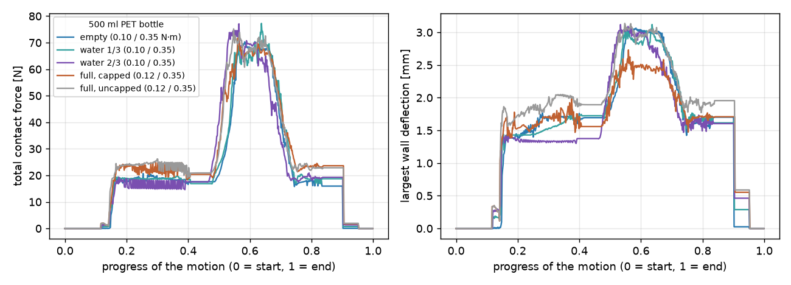

# PET 물병 쥐기

[플라스틱 컵 쥐기](plastic-cup.md)와 같은 동작으로 **500 ml PET 생수병**(몸통 지름 65 mm, 높이 205 mm, 벽 두께 0.25 mm)을
쥡니다. 옆에서 감싸 쥐고, 80 mm 들어 올려 더 세게 쥐었다가 풀고, 내려놓습니다. **빈 병, 물 1/3, 물 2/3, 가득(마개 닫음),
가득(마개 엶)** 다섯 경우를 비교합니다. 병 벽의 색은 변형 방향(적색: 바깥으로, 청색: 안쪽으로)입니다. 기준: 2026-10-24,
Isaac Sim 5.0.0.

병 몸통은 컵보다 훨씬 단단합니다. 몸통 가운데에서 지름을 6.35 mm 줄이는 데 **9.8 N**이 듭니다(모델 추정값, PET 컵 16 oz는 0.7 N).
그래서 종이컵과 같은 토크(쥐기 0.10 N·m, 꽉 쥐기 0.35 N·m)로 쥐었습니다.

## 가득 — 499 ml, 병과 물 513 g, 마개 닫음 (쥐기 0.12 N·m, 꽉 쥐기 0.35 N·m)

<video class="mde-video" src="../media/bottle-full-grasp.mp4" poster="../media/bottle-full-grasp.jpg" controls muted loop playsinline></video>

<figure><figcaption>쥐기 전</figcaption></figure>
<figure><figcaption>80 mm 들어 올림 (0.12 N·m)</figcaption></figure>
<figure><figcaption>꽉 쥐었을 때 (0.35 N·m)</figcaption></figure>
<figure><figcaption>꽉 쥐었을 때 위에서</figcaption></figure>

## 가득 — 마개 엶 (쥐기 0.12 N·m, 꽉 쥐기 0.35 N·m)

<video class="mde-video" src="../media/bottle-open-grasp.mp4" poster="../media/bottle-open-grasp.jpg" controls muted loop playsinline></video>

<figure><figcaption>80 mm 들어 올림</figcaption></figure>
<figure><figcaption>꽉 쥐었을 때</figcaption></figure>
<figure><figcaption>꽉 쥐었을 때 위에서</figcaption></figure>

## 빈 병 · 물 1/3 · 물 2/3 (쥐기 0.10 N·m, 꽉 쥐기 0.35 N·m)

<figure><video class="mde-video" src="../media/bottle-empty-grasp.mp4" poster="../media/bottle-empty-grasp.jpg" controls muted loop playsinline></video><figcaption>빈 병 (14 g)</figcaption></figure>
<figure><video class="mde-video" src="../media/bottle-13-grasp.mp4" poster="../media/bottle-13-grasp.jpg" controls muted loop playsinline></video><figcaption>물 1/3 — 173 ml, 187 g</figcaption></figure>
<figure><video class="mde-video" src="../media/bottle-23-grasp.mp4" poster="../media/bottle-23-grasp.jpg" controls muted loop playsinline></video><figcaption>물 2/3 — 347 ml, 361 g</figcaption></figure>

<figure><figcaption>빈 병 — 쥐기 전</figcaption></figure>
<figure><figcaption>물 1/3 — 쥐기 전</figcaption></figure>
<figure><figcaption>물 2/3 — 쥐기 전</figcaption></figure>

## 결과

| | 빈 병 | 물 1/3 | 물 2/3 | 가득, 마개 닫음 | 가득, 마개 엶 |
|---|---|---|---|---|---|
| 병과 물의 무게 | 14 g | 187 g | 361 g | 513 g | 513 g |
| 쥐기 / 꽉 쥐기 설정 | 0.10 / 0.35 N·m | 0.10 / 0.35 | 0.10 / 0.35 | 0.12 / 0.35 | 0.12 / 0.35 |
| 쥐었을 때 접촉력 | 11.6 N | 18.1 N | 18.0 N | 13.6 N | 14.7 N |
| 들고 있을 때 접촉력 | 17.1 N | 18.1 N | 19.6 N | 24.1 N | 23.1 N |
| 꽉 쥐었을 때 접촉력 | 64.9 N | 67.0 N | 67.9 N | 65.2 N | 61.3 N |
| 벽 변위 최대 | 2.33 mm | 2.35 mm | 2.43 mm | 2.22 mm | 2.38 mm |
| 병 안 압력 상승 최대 | — | — | — | 1.2 kPa | — |
| 마찰 여유 (들고 있는 동안 최소) | 56배 | 3.7배 | 2.4배 | 2.0배 | 1.8배 |
| 관절 토크 최대 | 0.84 N·m | 1.09 N·m | 0.92 N·m | 0.84 N·m | 1.01 N·m |

{ loading=lazy }

- 마개를 닫은 병은 연 병보다 벽 변위 최대가 7 % 작습니다(2.22 대 2.38 mm). 다만 두 경우 손가락이 닿는 순서와 힘이 조금씩
  달라, 이 차이가 모두 마개 때문이라고 할 수는 없습니다. 이 정도 변위(2 mm)에서는 마개의 영향이 작습니다.
- 가득 찬 병은 처음에 0.10 N·m로 쥐었습니다. 마개를 연 경우 들고 있는 동안 마찰 여유가 한 스텝 0.98로 1보다 작아져, 그 결과는
  쓰지 않고 두 경우 모두 0.12 N·m로 다시 쥐었습니다.
- 꽉 쥐는 동안 관절 토크 최대(0.84–1.09 N·m)는 Allegro Hand 관절 한계 0.7 N·m를 넘습니다. 종이컵(1.11 N·m)과 같은 성격입니다.

데이터(스텝·단계·설정·접촉력 합과 손가락별·벽 변위·병 높이·마찰이 받친 무게·수면 높이·병 안 압력·관절 16개 토크):
[빈 병](data/bottle-empty-grasp.csv) · [물 1/3](data/bottle-13-grasp.csv) · [물 2/3](data/bottle-23-grasp.csv) ·
[가득, 마개 닫음](data/bottle-full-grasp.csv) · [가득, 마개 엶](data/bottle-open-grasp.csv)

!!! warning "한계"
    - **점검 결과(2026-10-25)**: 병 질량(14 g)과 벽 두께(0.25 mm)가 경량 생수병(8–11 g, 평균 0.12–0.18 mm)보다 크고 서로 맞지
      않습니다. 꽉 쥐기에서 손가락 하나의 힘(18–22 N)은 Allegro Hand 손끝 능력을 넘습니다 → [추정값·힘 점검](check.md)
    - **병의 옆벽 강성은 실측값이 아닙니다.** 병 치수·벽 두께·PET 탄성계수에서 계산한 추정값입니다. 실제 생수병에는 대부분
      가로 줄무늬(리브)나 그립 패널이 있어 이 모델보다 단단합니다.
    - 병 벽은 **탄성만** 표현합니다. 꺾이거나 찌그러진 채 남는 변형, 어깨와 바닥의 변형은 없습니다. 어깨·목·마개는 그림입니다.
    - 물은 무게(마개를 닫은 경우 병 안 압력 포함)로만 들어갑니다. 출렁임·관성은 없고, 병은 기울지 않습니다.
    - 병 무게(14 g)와 손가락 마찰계수(0.5)는 실측값이 아닙니다. 관절 토크는 시뮬레이션의 접촉력에서 계산한 값입니다.
