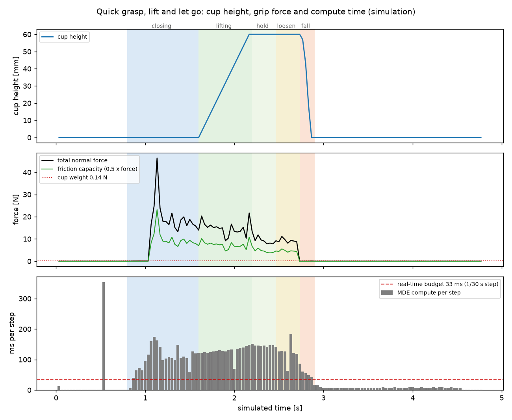

# 대표 데모 — 빠르게 쥐었다 놓치기

Allegro Hand가 탁자 위 종이컵을 **빠르게 쥐고, 60 mm 들어 올렸다가, 쥐는 힘을 풀어 놓치는** 장면입니다. 컵은 손가락 사이로
떨어져 탁자에 닿습니다. 시뮬레이션 한 스텝을 1/30 s로 두어 동작 전체가 4.8 s(143 스텝)이고, 영상도 같은 시간으로 재생됩니다.
매 스텝 계산에 걸린 시간을 함께 기록해 **실시간으로 돌 수 있는지**를 봅니다. 기준: 2026-10-24, Isaac Sim 5.0.0.

<video class="mde-video" src="../media/cup-quick.mp4" poster="../media/cup-quick.jpg" controls muted loop playsinline></video>

<figure><figcaption>쥐었을 때 (0.8 s 만에 닫음)</figcaption></figure>
<figure><figcaption>60 mm 들고 유지</figcaption></figure>
<figure><figcaption>놓친 뒤 — 컵이 탁자로 떨어짐</figcaption></figure>

## 동작

| 단계 | 시간 | 내용 |
|---|---|---|
| 다가가기·예비 자세 | 0 – 0.8 s | 80 mm 옆에서 다가가 손가락을 컵에 닿기 직전까지 굽힘 |
| 쥐기 | 0.8 – 1.6 s | 관절 토크 0.10 N·m까지 닫음 |
| 들기·유지 | 1.6 – 2.5 s | 60 mm 들어 올려 유지 |
| 풀기 | 2.5 – 2.7 s | 쥐는 토크를 0.02 N·m까지 낮춤 |
| 놓치기·낙하 | 2.7 – 2.9 s | 모든 관절을 함께 엶 → 접촉이 끊기고 컵이 떨어짐 |
| 물러나기 | 2.9 – 4.8 s | 손을 펴고 물러남 |

## 결과

{ loading=lazy }

- 들고 있는 동안 쥐는 힘은 약 8–20 N입니다. 마찰로 버틸 수 있는 힘(마찰계수 0.5 × 쥐는 힘, 4–10 N)이 컵 무게 0.14 N보다 훨씬 커서
  컵이 미끄러지지 않습니다.
- 손가락을 여는 첫 스텝에 접촉이 모두 끊깁니다. 컵은 60 mm를 0.13 s(5 스텝) 만에 떨어집니다. 자유낙하 이론값은 0.11 s입니다.
- 관절 토크 최대는 0.97 N·m로, 쥐기 중 한 스텝에서 나온 순간값입니다.

## 실시간성

| 구간 | 스텝 수 | 스텝당 계산 시간(평균 / 최대) | 실시간 기준 33 ms 대비 |
|---|---|---|---|
| 접촉 없음 (다가가기·낙하 뒤·물러나기) | 72 | 1.5–8 ms / 16 ms | 실시간 |
| 쥐기 | 24 | 100 ms / 174 ms | 약 3배 느림 |
| 들기·유지·풀기 | 34 | 127–146 ms / 185 ms | 약 4배 느림 |
| 전체 | 143 | 56 ms / 355 ms | 실시간 대비 0.60배 |

**손이 컵에 닿아 있는 동안은 아직 실시간이 아닙니다.** 접촉 구간만 보면 실시간 대비 약 0.23–0.33배이고, 전체의 0.60배는
접촉 없는 스텝이 끌어올린 값입니다. 예비 자세 첫 스텝의 355 ms는 손가락마다 닿는 지점을 찾는 한 번의 준비 계산입니다.
계산 시간은 렌더링을 제외한 변형 엔진 계산만 잰 값이며, Isaac Sim과 같은 PC(CPU)에서 동시에 돌렸습니다.

데이터: [cup-quick-demo.csv](data/cup-quick-demo.csv) — 시각·단계·설정·접촉력(합·손가락별)·마찰 여유·컵 무게·컵 높이·낙하 속도·스텝당 계산 시간·관절 16개 토크

!!! warning "결과를 읽을 때"
    - 시뮬레이션 결과이며 실제 로봇으로 시험한 것이 아닙니다. 물성(종이·마찰·질량)은 잠정값입니다.
    - 컵은 기울거나 회전하지 않고, 평면 이동과 높이 변화만 표현합니다. 탁자에 닿을 때의 튐은 없습니다.
    - 관절 토크는 관절 센서 값이 아니라 시뮬레이션의 접촉 법선력에서 계산한 값입니다(마찰 제외).
