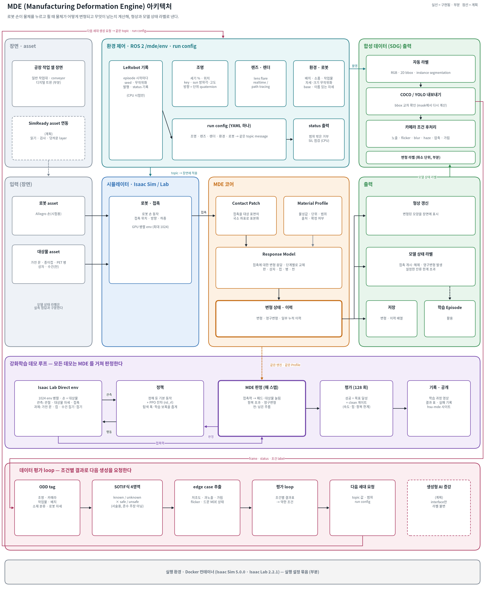

# MDE 소개 · 기능

기준일 2026-11-28 · 상태 표기: <span class="mde-st done">구현됨</span> 구현했고 시험을 통과함 ·
<span class="mde-st part">부분</span> 일부만 구현됨 · <span class="mde-st plan">계획</span> 아직 구현하지 않음

MDE(Manufacturing Deformation Engine)는 로봇이 물체를 누르고 쥐고 집을 때 **물체가 얼마나 눌리고 무엇이 남는지**를 계산하는 층입니다.
물리 엔진(NVIDIA Isaac Sim의 PhysX)을 대체하지 않습니다. 움직임과 접촉력은 PhysX가 계산하고, MDE는 그 접촉을 받아
소재별 눌림·남은 자국·한계 초과를 계산해 판정과 라벨로 냅니다.

이 페이지는 MDE와 그 주변 도구(환경 제어, 합성 데이터 생성, 데이터 평가)의 기능을 한곳에 모은 것입니다.
실험 결과는 [개요](index.md)와 각 결과 페이지에 있습니다. 모든 결과는 **시뮬레이션**이며, MDE가 내는 값은 **추정값**입니다.
실물 시편이나 실제 로봇으로 확인한 값이 아닙니다.

## 구조

[](images/mde-architecture.png)

<p style="text-align:center"><small><b>MDE 아키텍처</b> — 가운데: 시뮬레이터의 접촉이 Contact Patch로 표본화되고, Material Profile과 Response Model을 거쳐 변형 상태·이력이 된 뒤 형상 갱신과 모델 상태 라벨로 나갑니다.
맨 위: ROS 2 <code>/mde/env</code> topic과 run config로 조명·렌즈·렌더·환경·로봇 조건을 바꾸고, 그 장면을 정답 라벨과 함께 촬영합니다.
강화학습 데모도 같은 엔진으로 매 스텝 판정합니다. 아래: 촬영한 데이터를 조건별로 나누어 평가하고, 약한 조건을 다음 생성 요청으로 돌려보냅니다.
실선은 구현됨·부분, 점선은 계획입니다. 클릭하면 원본 크기로 볼 수 있습니다.</small></p>

## 기능 표

| 기능 | 상태 | 내용 | 한계 |
|---|---|---|---|
| 접촉에 의한 변형 계산 (시뮬레이션) | <span class="mde-st done">구현됨</span> | PhysX가 낸 접촉을 받아 소재별 눌린 깊이, 손을 뗀 뒤 남은 자국, 한계 초과(금·찢김·항복)를 매 스텝 계산합니다. 강화학습의 판정에도 씁니다 | 소재 값은 문헌·제품 자료에서 잡은 **추정값·잠정값**이며 실측 보정 전입니다 |
| 합성 데이터 생성(SDG)과 자동 라벨 | <span class="mde-st done">구현됨</span> | RGB와 함께 2D bounding box, instance·semantic segmentation을 자동으로 저장합니다. COCO·YOLO 형식으로 내보내고, 내보낼 때 mask에서 다시 계산한 bbox와 저장된 bbox를 서로 대조합니다 | — |
| 조명 무작위화·제어 | <span class="mde-st done">구현됨</span> | 천장 조명·작업대 조명(key)·외광(sun)의 세기(기준 대비 %), 위치, key·sun의 방위각·고도, 방향(단위 quaternion), 색온도·색을 바꿉니다 | key 조명 방위각·고도 topic은 CPU 시험만 했습니다(아래 topic 표) |
| 소품·작업물 배치 무작위화 | <span class="mde-st done">구현됨</span> | 주변 소품(시각 전용) 배치, 작업물의 위치·자세·크기를 seed로 재현할 수 있게 추첨합니다 | 무작위화는 화면 조건만 바꿉니다. 소재 물성값은 바꾸지 않습니다 |
| ROS 2 환경 제어 `/mde/env` | <span class="mde-st done">구현됨</span> | 조명·카메라·렌더·배치·무작위화·촬영·episode를 ROS 2 topic으로 제어합니다. 범위 밖 값은 잘라 쓰지 않고 거부하며 `status`로 사유를 돌려줍니다. 2026-11-20 다른 프로세스에서 보낸 ROS 2 메시지가 장면에 적용되는 것을 Humble·Jazzy에서 각각 확인했습니다(응답 9/9) | 서로 다른 distro 사이의 송수신은 확인하지 않았습니다 |
| run config | <span class="mde-st done">구현됨</span> | 조명·렌즈·렌더·환경·로봇 설정을 YAML 하나로 묶습니다. 모든 설정은 같은 `/mde/env` topic 메시지로 바뀌므로 ROS 2로 할 수 없는 일을 하지 않습니다. 시간에 따른 sweep(예: 조명 궤도)도 적습니다 | — |
| 카메라 조건 후처리 | <span class="mde-st done">구현됨</span> | 촬영한 영상에 제조 현장 조건(노출 오차, 조명 flicker, 역광, 분진·증기 haze, 렌즈 오염, 움직임 blur, 압축·frame 손실, 손 가림 등)을 seed로 재현 가능하게 입힙니다. 가림이 생기면 segmentation·bbox 라벨도 따라 고칩니다 | 시각 전용입니다. renderer fog로 내는 haze는 영상에 작용하지 않아 계획으로 둡니다 |
| SIL 시나리오 점검 (CPU) | <span class="mde-st done">구현됨</span> | ROS·장면·GPU 없이 장면과 같은 제어 경로에 메시지를 넣어, 시나리오에 적은 `status`와 MDE 상태 생성·초기화가 나오는지 판정합니다 | — |
| LeRobot 기록 hook | <span class="mde-st done">구현됨</span> | LeRobot 형식으로 기록할 때 episode 시작마다 seed와 장면 무작위화를 보내고, 적용 결과를 episode별로 남깁니다(기본은 꺼짐) | **CPU 시험만** 했습니다. 실제 ROS 2 기록은 아직 돌리지 않았습니다 |
| ODD 분류와 SOTIF식 4영역 분류 | <span class="mde-st done">구현됨</span> | 데이터마다 운용 영역(ODD: 조명·카메라·작업물·배치·소재 분류·로봇 자세) tag를 달고, [ISO 21448(SOTIF)](https://www.iso.org/standard/77490.html)의 용어를 빌려 known/unknown × safe/unsafe 네 영역으로 나눕니다 | **데이터 분류를 위한 서술 용도**입니다. ISO 21448이나 다른 표준의 준수를 주장하지 않습니다 |
| edge case 추출 | <span class="mde-st done">구현됨</span> | 저조도·과노출·가림·flicker·blur·haze·frame 손실 frame과, 데이터 안에서 드문 MDE 상태가 나온 frame에 tag를 답니다 | 문턱은 데이터 선별 기준이며 MDE 판정 기준이 아닙니다 |
| 평가 loop · 다음 세대 생성 요청 | <span class="mde-st done">구현됨</span> | 평가 결과를 조건별 표로 묶어 약한 조건을 찾고, 그 조건을 다시 만드는 `/mde/env` topic 값·범위와 run config를 다음 생성 요청으로 냅니다 | CPU 시험만 했습니다. 실제 SDG 실행 결과에 loop를 끝까지 돌린 적은 아직 없습니다 |
| 디지털 트윈 | <span class="mde-st part">부분</span> | Isaac Sim 기본 제공 asset으로 만든 **일반 공장 작업 셀**(작업대·conveyor·부품 상자) 장면만 있습니다 | 특정 현장을 옮긴 트윈이 아닙니다 |
| 화소 단위 변형 라벨 | <span class="mde-st part">부분</span> | frame마다 MDE 변형 배열과 모델 상태 라벨을 RGB와 같은 번호로 저장합니다 | 대상 종류 일부에서만 확인했습니다. 영상 화소에 맞춘 변형 라벨은 일부만 됩니다 |
| Docker 실행 묶음 | <span class="mde-st part">부분</span> | Isaac Sim 5.0.0·Isaac Lab 2.2.1을 host에 설치하지 않고 Docker 컨테이너로 실행합니다([설치와 예제 실행](index.md#설치와-예제-실행)) | 장면·설정·의존성을 한 묶음으로 내려받아 바로 돌리는 형태는 일부만 됩니다 |
| 생성형 AI 증강 | <span class="mde-st plan">계획</span> | 라벨(segmentation·depth)은 그대로 두고 영상만 바꾸는 interface와 검사 규칙은 있습니다 | 생성 모델은 붙이지 않았습니다. 모델·데이터 라이선스 검토 뒤 결정합니다 |
| SimReady asset 연동 | <span class="mde-st plan">계획</span> | 아래 [NVIDIA SimReady asset 연동](#simready) 절 | 아직 SimReady asset으로 시험한 결과가 없습니다 |
| sim-to-real 미끄러짐·접촉 변형 재현 | <span class="mde-st plan">계획(실측 전)</span> | 실물 측정과 대조하는 단계입니다 | 실물 측정을 하지 않았습니다. 시뮬레이션 결과를 실물 재현으로 주장하지 않습니다 |

## ROS 2 환경 제어 topic { #ros2-topics }

- 모든 topic은 `/mde/env` 아래에 있습니다. 범위 밖 값은 잘라 쓰지 않고 메시지 전체를 거부하며, 결과는 `status`로 나옵니다.
- 메시지 타입은 `std_msgs`·`geometry_msgs`뿐이며 ROS 2 Humble·Jazzy에서 정의가 같습니다.
- **ROS 2 publish 확인**: 2026-11-20 Humble·Jazzy에서 각각 다른 프로세스가 보낸 메시지 9건이 장면에 적용되고 `status` 9/9가 돌아왔습니다(같은 distro끼리. 서로 다른 distro는 미확인).
  9건은 천장 조명 켜기·세기(범위 밖 값 거부 포함), 외광 방위각·고도, `randomize/all`, `objects/spawn`, `episode/reset`, `capture/trigger`입니다.
  나머지 topic은 host 시험(검증·명령)과 ROS 없이 같은 메시지를 넣는 GPU 장면 시험으로 확인했습니다.
- 카메라 조건 topic(`camera/condition/*`, `camera/render/*`)은 2026-11-20 Isaac Sim ROS 2(Humble) 구동에서 `status` 16/16으로 확인했습니다.
- 상태: <span class="mde-st done">구현됨</span> = 구현했고 시험을 통과한 topic. <span class="mde-st plan">계획</span> = 그 밖(구현했어도 영상에 작용하지 않거나 시험을 통과하지 못한 것 포함).

??? note "1. 조명 (17개)"

    | Topic | 메시지 타입 | 의미 | 범위 | 상태 |
    |---|---|---|---|---|
    | `lights/ceiling/enable` | std_msgs/Bool | 천장 조명 group 켬/끔 | — | <span class="mde-st done">구현됨</span> ROS 2 publish 확인 |
    | `lights/ceiling/intensity` | std_msgs/Float32 | 천장 조명 세기(원래 세기 대비) | 0–10000 % | <span class="mde-st done">구현됨</span> ROS 2 publish 확인 |
    | `lights/ceiling/color_temperature` | std_msgs/Float32 | 천장 조명 색온도 | 1000–15000 K | <span class="mde-st done">구현됨</span> |
    | `lights/ceiling/color` | std_msgs/ColorRGBA | 천장 조명 RGB 색 | 성분 0–1 | <span class="mde-st done">구현됨</span> |
    | `lights/key/enable` | std_msgs/Bool | 작업대 위 key 조명 켬/끔 | — | <span class="mde-st done">구현됨</span> |
    | `lights/key/intensity` | std_msgs/Float32 | key 조명 세기 | 0–10000 % | <span class="mde-st done">구현됨</span> |
    | `lights/key/pose` | geometry_msgs/Pose | key 조명 위치·방향 | 단위 quaternion(±1 %) | <span class="mde-st done">구현됨</span> |
    | `lights/key/azimuth_elevation` | geometry_msgs/Vector3 | key 조명을 조준점 둘레에 배치: x 방위각, y 고도, z 거리(0 = 현재 거리 유지) | x −360–360 deg, y 0–90 deg, z 0–20 m | <span class="mde-st done">구현됨</span> CPU 시험만, ROS 2 publish 미확인 |
    | `lights/key/radius` | std_msgs/Float32 | key 조명 광원 반경(그림자 경계) | 0.001–5 m | <span class="mde-st done">구현됨</span> |
    | `lights/key/color_temperature` | std_msgs/Float32 | key 조명 색온도 | 1000–15000 K | <span class="mde-st done">구현됨</span> |
    | `lights/key/color` | std_msgs/ColorRGBA | key 조명 RGB 색 | 성분 0–1 | <span class="mde-st done">구현됨</span> |
    | `lights/sun/enable` | std_msgs/Bool | 외광(directional) 켬/끔 | — | <span class="mde-st done">구현됨</span> |
    | `lights/sun/intensity` | std_msgs/Float32 | 외광 세기 | 0–10000 % | <span class="mde-st done">구현됨</span> |
    | `lights/sun/pose` | geometry_msgs/Pose | 외광 방향(orientation만 사용) | 단위 quaternion | <span class="mde-st done">구현됨</span> |
    | `lights/sun/azimuth_elevation` | geometry_msgs/Vector3 | 외광 방위각·고도 | x −360–360 deg, y −90–90 deg | <span class="mde-st done">구현됨</span> ROS 2 publish 확인 |
    | `lights/sun/color_temperature` | std_msgs/Float32 | 외광 색온도 | 1000–15000 K | <span class="mde-st done">구현됨</span> |
    | `lights/sun/angular_size` | std_msgs/Float32 | 외광 각크기(그림자 경계) | 0–30 deg | <span class="mde-st done">구현됨</span> |

??? note "2. 카메라·렌더러 (10개)"

    | Topic | 메시지 타입 | 의미 | 범위 | 상태 |
    |---|---|---|---|---|
    | `camera/pose` | geometry_msgs/Pose | 촬영 카메라 위치·방향 | 단위 quaternion | <span class="mde-st done">구현됨</span> |
    | `camera/lens_flare/enable` | std_msgs/Bool | lens flare 켬/끔 | — | <span class="mde-st done">구현됨</span> |
    | `camera/lens_flare/blades` | std_msgs/Int32 | 조리개 날 수 | 3–32 | <span class="mde-st done">구현됨</span> |
    | `camera/lens_flare/scale` | std_msgs/Float32 | flare 크기 | 0.001–10 | <span class="mde-st done">구현됨</span> |
    | `camera/lens_flare/aperture_rotation` | std_msgs/Float32 | 조리개 회전 | −360–360 deg | <span class="mde-st done">구현됨</span> |
    | `camera/lens_flare/focal_length` | std_msgs/Float32 | 초점거리 | 1–1000 mm | <span class="mde-st done">구현됨</span> |
    | `camera/lens_flare/fstop` | std_msgs/Float32 | F 값 | 0.5–64 | <span class="mde-st done">구현됨</span> |
    | `camera/lens_flare/sensor_aspect_ratio` | std_msgs/Float32 | 센서 가로세로 비 | 0.1–10 | <span class="mde-st done">구현됨</span> |
    | `camera/lens_flare/sensor_diagonal` | std_msgs/Float32 | 센서 대각선 | 1–100 mm | <span class="mde-st done">구현됨</span> |
    | `render/mode` | std_msgs/String | 렌더러 모드 | `realtime` 또는 `path_tracing` | <span class="mde-st done">구현됨</span> |

??? note "3. 배치·무작위화·촬영 (11개)"

    | Topic | 메시지 타입 | 의미 | 범위 | 상태 |
    |---|---|---|---|---|
    | `layout/select` | std_msgs/Int32 | 작업대·conveyor 배치 preset 선택 | 0–63 (장면 preset 수 미만) | <span class="mde-st done">구현됨</span> |
    | `layout/table/pose` | geometry_msgs/Pose | 작업대 자세 | 단위 quaternion | <span class="mde-st done">구현됨</span> |
    | `layout/conveyor/pose` | geometry_msgs/Pose | conveyor 자세 | 단위 quaternion | <span class="mde-st done">구현됨</span> |
    | `clutter/enable` | std_msgs/Bool | 주변 소품(시각 전용) 표시/숨김 | — | <span class="mde-st done">구현됨</span> |
    | `randomize/seed` | std_msgs/Int32 | 난수 generator 재설정(재현용) | 0–2147483647 | <span class="mde-st done">구현됨</span> |
    | `randomize/clutter` | std_msgs/Int32 | 소품 N개를 무작위 배치 | 1–64 (장면 자리 수까지) | <span class="mde-st done">구현됨</span> |
    | `randomize/lights` | std_msgs/Empty | 조명 세기·색온도·방향 추첨 | 장면 설정 범위 | <span class="mde-st done">구현됨</span> |
    | `randomize/materials` | std_msgs/Empty | 소품 표시 재질 추첨(물성값은 바꾸지 않음) | 장면 palette | <span class="mde-st done">구현됨</span> |
    | `randomize/camera` | std_msgs/Empty | 카메라 시점 추첨 | 장면 설정 범위 | <span class="mde-st done">구현됨</span> |
    | `randomize/all` | std_msgs/Empty | 위 넷을 한 번에 | — | <span class="mde-st done">구현됨</span> ROS 2 publish 확인 |
    | `capture/trigger` | std_msgs/Int32 | N frame 촬영: RGB, 2D box, instance·semantic segmentation(선택: depth) | 1–10000 | <span class="mde-st done">구현됨</span> ROS 2 publish 확인 |

??? note "4. Episode — 작업물·로봇·초기화 (9개)"

    | Topic | 메시지 타입 | 의미 | 범위 | 상태 |
    |---|---|---|---|---|
    | `objects/spawn` | std_msgs/String (JSON) | 허용 목록의 작업물을 배치 | 장면 작업 공간 안 | <span class="mde-st done">구현됨</span> ROS 2 publish 확인 |
    | `objects/despawn` | std_msgs/String | 작업물 제거 | 물체 이름 | <span class="mde-st done">구현됨</span> |
    | `objects/reset` | std_msgs/String | 작업물 초기화(MDE 변형·상태도 초기화) | 물체 이름 | <span class="mde-st done">구현됨</span> |
    | `objects/teleport` | std_msgs/String (JSON) | 작업물 위치 이동 | 장면 작업 공간 안 | <span class="mde-st done">구현됨</span> |
    | `robot/base/teleport` | geometry_msgs/Pose | 로봇 base 이동(기울이는 회전은 거부) | 로봇 작업 공간 안 | <span class="mde-st done">구현됨</span> |
    | `robot/posture` | std_msgs/String | 이름 있는 관절 자세 적용 | 자세 이름(관절 한계 안) | <span class="mde-st done">구현됨</span> |
    | `episode/reset` | std_msgs/Empty | episode 전체 초기화 | — | <span class="mde-st done">구현됨</span> ROS 2 publish 확인 |
    | `workpiece/swap` | std_msgs/String | 작업물 종류 교체(장면 재시작) | 허용 목록 | <span class="mde-st done">구현됨</span> |
    | **출력** `status` | std_msgs/String (JSON) | 메시지마다 결과 `{topic, ok, error, commands, seed}` | — | <span class="mde-st done">구현됨</span> ROS 2 publish 확인 |

    장면마다 받는 episode 동작이 다릅니다. 예를 들어 컵 쥐기 장면은 reset·episode reset·swap만 받고 spawn·despawn·teleport는 거부합니다.

??? note "5. 카메라 조건 — 영상 후처리 (18개)"

    | Topic | 메시지 타입 | 의미 | 범위 | 상태 |
    |---|---|---|---|---|
    | `camera/condition/enable` | std_msgs/Bool | 영상 조건 켬/끔 | — | <span class="mde-st done">구현됨</span> Isaac ROS 2 확인 |
    | `camera/condition/preset` | std_msgs/String | 조건 preset 선택 | preset 이름 | <span class="mde-st done">구현됨</span> Isaac ROS 2 확인 |
    | `camera/condition/seed` | std_msgs/Int32 | 기준 seed | 0–2147483647 | <span class="mde-st done">구현됨</span> |
    | `camera/condition/randomize` | std_msgs/Empty | preset·seed 추첨 | — | <span class="mde-st done">구현됨</span> |
    | `camera/condition/clear_overrides` | std_msgs/Empty | 개별 지정값 모두 해제 | — | <span class="mde-st done">구현됨</span> Isaac ROS 2 확인 |
    | `camera/condition/exposure_ev` | std_msgs/Float32 | 노출 오차 | −6–6 EV | <span class="mde-st done">구현됨</span> Isaac ROS 2 확인 |
    | `camera/condition/illumination` | std_msgs/Float32 | 조도 배율 | 0.001–100 | <span class="mde-st done">구현됨</span> |
    | `camera/condition/color_temperature` | std_msgs/Float32 | 장면 색온도(white balance) | 1667–25000 K | <span class="mde-st done">구현됨</span> |
    | `camera/condition/flicker_hz` | std_msgs/Float32 | 조명 flicker 전원 주파수 | 40–70 Hz | <span class="mde-st done">구현됨</span> |
    | `camera/condition/flicker_depth` | std_msgs/Float32 | flicker 변조 깊이 | 0–1 | <span class="mde-st done">구현됨</span> |
    | `camera/condition/haze_density` | std_msgs/Float32 | 영상 haze 감쇠 정도 | 0–10 /m | <span class="mde-st done">구현됨</span> |
    | `camera/condition/motion_blur` | std_msgs/Float32 | motion blur 속도 | 0–100000 px/s | <span class="mde-st done">구현됨</span> |
    | `camera/condition/defocus` | std_msgs/Float32 | 초점 흐림 반경 | 0–50 px | <span class="mde-st done">구현됨</span> |
    | `camera/condition/read_noise` | std_msgs/Float32 | 센서 read noise | 0–1000 e− | <span class="mde-st done">구현됨</span> |
    | `camera/condition/jpeg_quality` | std_msgs/Int32 | JPEG 압축 품질 | 1–100 | <span class="mde-st done">구현됨</span> |
    | `camera/condition/drop_rate` | std_msgs/Float32 | stream frame 손실 확률 | 0–1 | <span class="mde-st done">구현됨</span> |
    | **출력** `camera/condition/status` | std_msgs/String (JSON) | 메시지마다 결과 | — | <span class="mde-st done">구현됨</span> Isaac ROS 2 확인 |
    | **출력** `camera/condition/labels` | std_msgs/String (JSON) | 처리한 frame마다 조건 라벨 | — | <span class="mde-st done">구현됨</span> Isaac ROS 2 확인 |

??? note "6. 카메라 조건 — 렌더러 쪽 (11개)"

    | Topic | 메시지 타입 | 의미 | 범위 | 상태 |
    |---|---|---|---|---|
    | `camera/render/flicker/enable` | std_msgs/Bool | 천장 조명 flicker 켬/끔 | — | <span class="mde-st done">구현됨</span> Isaac ROS 2 확인 |
    | `camera/render/flicker/mains_hz` | std_msgs/Float32 | flicker 전원 주파수 | 40–70 Hz | <span class="mde-st done">구현됨</span> Isaac ROS 2 확인 |
    | `camera/render/flicker/depth` | std_msgs/Float32 | flicker 깊이 | 0–1 | <span class="mde-st done">구현됨</span> Isaac ROS 2 확인 |
    | `camera/render/backlight/enable` | std_msgs/Bool | 창 역광 켬/끔 | — | <span class="mde-st done">구현됨</span> Isaac ROS 2 확인 |
    | `camera/render/backlight/intensity` | std_msgs/Float32 | 역광 세기 | 0–10000 % | <span class="mde-st done">구현됨</span> Isaac ROS 2 확인 |
    | `camera/render/backlight/pose` | geometry_msgs/Pose | 역광 창 위치·방향 | 단위 quaternion | <span class="mde-st done">구현됨</span> Isaac ROS 2 확인 |
    | `camera/render/glare/enable` | std_msgs/Bool | 대상 표면 금속 반사 look 켬/끔(표시 재질만) | — | <span class="mde-st done">구현됨</span> Isaac ROS 2 확인 |
    | `camera/render/glare/roughness` | std_msgs/Float32 | 반사 거칠기 | 0.01–1 | <span class="mde-st done">구현됨</span> Isaac ROS 2 확인 |
    | `camera/render/haze/enable` | std_msgs/Bool | renderer fog 켬/끔 | — | <span class="mde-st plan">계획</span> 설정은 적용되나 영상에 작용하지 않음(GPU 장면 시험 FAIL). 거리에 따른 haze는 영상 후처리 `haze_density`로 냅니다 |
    | `camera/render/haze/density` | std_msgs/Float32 | renderer fog 밀도 | 0–10 /m | <span class="mde-st plan">계획</span> 위와 같음 |
    | `camera/render/workpiece/randomize` | std_msgs/Empty | 작업물 표시 외관 추첨 | — | <span class="mde-st done">구현됨</span> GPU 장면 시험 PASS, ROS 2로는 아직 보내 보지 않음 |

```bash
ros2 topic pub --once /mde/env/lights/sun/azimuth_elevation geometry_msgs/msg/Vector3 "{x: 135.0, y: 30.0, z: 0.0}"
ros2 topic pub --once /mde/env/randomize/all std_msgs/msg/Empty "{}"
ros2 topic pub --once /mde/env/capture/trigger std_msgs/msg/Int32 "{data: 100}"
```

## NVIDIA SimReady asset 연동 <span class="mde-st plan">계획</span> { #simready }

기준일 2026-11-27 · [SimReady Foundation](https://github.com/NVIDIA/simready-foundation) 공개 사양(2026-11-23 판)과 Isaac Sim 5.0.0 기준 · 이 절의 모든 항목은 **계획**입니다

**SimReady**는 NVIDIA가 정한 OpenUSD 기반 시뮬레이션용 asset 규격입니다([NVIDIA 용어집: What Is SimReady?](https://www.nvidia.com/en-us/glossary/simready/),
[SimReady Foundation 시작 안내](https://nvidia.github.io/simready-foundation/latest/guides/getting_started.html)). 단위·좌표축, 강체·충돌 형상·질량,
마찰·반발 같은 물리 재질, 화면용 재질, 센서용 재질 표시, 의미 라벨(무엇인지·무엇으로 만들었는지)을 정해진 방식으로 담고,
공개 검사 도구로 규격에 맞는지 확인합니다. SimReady asset은 물리 엔진에서 **강체**로 움직이도록 만들어집니다.
공개 사양에는 물체가 눌리거나 접히거나 자국이 남는 성질을 담는 항목이 없습니다.

MDE는 그 빈 곳을 맡는 층으로 연동할 계획입니다. SimReady asset은 그대로 두고, 그 위에서 소재 응답과 남는 상태를 계산합니다.

| 단계 | 하는 일 | 상태 |
|---|---|---|
| 읽기 | asset의 단위·좌표축, 강체·질량, 물리 재질, 재질 종류 표시, 의미 라벨, 라이선스 표기를 읽고 검사합니다. asset 파일은 고치지 않습니다 | <span class="mde-st plan">계획</span> |
| 소재 연결 | 재질 종류 표시는 소재 분류의 **후보**로만 씁니다. 어떤 Material Profile을 쓸지는 사람이 정합니다. 맞는 분류가 없으면 「알 수 없음」으로 두고, MDE 판정을 하지 않았다고 표시합니다 | <span class="mde-st plan">계획</span> |
| 값의 출처 | asset에서 가져온 마찰·질량 값에는 「asset 표기값, 실측 아님」이라는 출처를 붙입니다. 변형·항복 같은 소재 응답 값은 asset에 없으므로 asset에서 만들지 않고 Material Profile에서 가져옵니다 | <span class="mde-st plan">계획</span> |
| 변형 계산 | 지금의 강화학습 데모처럼 물체는 물리 엔진에서 강체로 움직이고, MDE가 접촉력으로 눌림·남은 자국·한계 초과를 판정합니다 | <span class="mde-st plan">계획</span> (MDE 쪽 계산은 동작 중, SimReady asset으로는 시험 전) |
| 자동 라벨 | asset에 들어 있는 의미 라벨로 2D bounding box·instance/semantic segmentation을 만들고, 장면마다 모델 상태 라벨(눌림·남은 자국·한계 초과)을 함께 저장합니다 | <span class="mde-st plan">계획</span> |
| 내보내기 | MDE가 붙인 정보(쓴 Profile과 판, 값의 출처)를 원본 위에 **덧씌우는 별도 USD layer**로 저장하고, 합친 결과를 SimReady 검사 도구로 다시 확인합니다 | <span class="mde-st plan">계획</span> |

- **원본을 바꾸지 않습니다.** MDE가 쓰는 내용은 모두 별도 layer에 두어, 그 layer를 빼면 원래 asset으로 돌아가게 합니다.
- **값을 지어내지 않습니다.** asset에 없는 값은 비워 두고 「알 수 없음」으로 표시합니다. asset의 마찰값과 Profile의 마찰값이 다르면 Profile 값을 쓰고 차이를 기록합니다.
- **충돌 형상의 한계.** SimReady asset의 충돌 형상은 계산을 빠르게 하려고 단순화되어 있을 수 있습니다. 눈에 보이는 표면과 물리 엔진이 닿는 면이 조금 다를 수 있으므로, 어떤 충돌 형상을 썼는지 결과와 함께 기록할 계획입니다.
- **시간에 따라 바뀌는 상태 라벨.** 렌더 라벨은 물체마다 고정된 라벨 하나를 씁니다. 그래서 「눌림」「남은 자국」처럼 시간에 따라 바뀌는 MDE 상태는 장면별 라벨 파일에 따로 저장할 계획입니다.
- **라이선스.** SimReady asset은 asset마다 라이선스가 다릅니다. 사용 전에 각 asset의 라이선스 표기를 확인하고, asset 파일이나 그 형상을 이 사이트에 다시 배포하지 않습니다.
- **버전.** SimReady 사양과 검사 도구는 판이 자주 바뀝니다. 결과마다 검사한 사양 이름과 판을 함께 기록할 계획입니다.

공개 SimReady asset 네 개를 읽어 규격을 설명하고 MDE 공개 Profile 과 비교한 결과는 [SimReady asset 과 MDE](simready.md) 페이지에 있습니다(asset 파일 분석, GPU 장면 시험 전).

아직 SimReady asset으로 장면에서 시험한 결과는 없습니다. 먼저 GPU 없이 asset의 정보를 읽고 검사하는 단계를 만든 뒤, Isaac Sim 장면에서
라벨과 판정을 확인하는 순서로 진행할 계획입니다.

## 로드맵 { #roadmap }

이 사이트에 이미 공개한 과제와 이 페이지의 기능만 적었습니다. 날짜는 이 사이트에 처음 공개한 날입니다.

| 시기 | 항목 | 상태 | 내용 |
|---|---|---|---|
| 2026-10-27 ~ 11-05 | [가전 문 열기 강화학습](rl-door.md) | <span class="mde-st done">구현됨</span> | 막대 손잡이·문 틈 열기, 손끝 패드 눌림·항복 판정 |
| 2026-10-29 ~ 10-31 | 천 — [수건 접기](towel.md)·[수건 집기](towel-pick.md) | <span class="mde-st part">부분</span> | 1번 접기·집기는 결과 공개. 2번 접기는 겹친 천을 다루도록 천 모델을 바꾼 뒤 다시 학습할 계획 |
| 2026-10-30 · 11-27 | [Newton·RaiSim과 비교](newton.md) | <span class="mde-st part">부분</span> | 역할 비교 문서는 공개. 다른 물리 엔진 위에서 MDE를 돌리는 시험은 계획(아직 시험하지 않음) |
| 2026-11-05 | 글씨 쓰기 — [펜 쥐기](pen-grasp.md) → 획 긋기 → 알파벳 | <span class="mde-st part">부분</span> | 1단계 펜 쥐기는 결과 공개. 획 긋기와 알파벳은 계획 |
| 2026-11-19 ~ 11-28 | 환경 제어·합성 데이터(SDG) | <span class="mde-st done">구현됨</span> | ROS 2 `/mde/env`, run config, 자동 라벨·COCO/YOLO, 카메라 조건. 디지털 트윈은 일반 작업 셀만(부분) |
| 2026-11-28 | ODD·SOTIF식 분류와 평가 loop | <span class="mde-st done">구현됨</span> | CPU 시험까지. 실제 합성 데이터 실행에 loop를 끝까지 돌리는 것은 계획 |
| 다음 | 생성형 AI 증강 | <span class="mde-st plan">계획</span> | interface만 있음. 모델은 라이선스 검토 뒤 |
| 다음 | [SimReady asset 연동](#simready) | <span class="mde-st plan">계획</span> | 읽기·검사부터 |
| 다음 | sim-to-real 미끄러짐·접촉 변형 재현 | <span class="mde-st plan">계획(실측 전)</span> | 실물 측정이 먼저입니다 |

!!! warning "읽을 때"
    - MDE는 PhysX 위에서 도는 층입니다. 물리 엔진을 대체하거나 더 낫다고 주장하지 않습니다.
    - MDE가 내는 값은 시뮬레이션 모델의 **추정값**입니다. 실제 로봇이나 실물의 결과를 예측한다고 주장하지 않습니다.
    - 강화학습 결과는 과제마다 seed 1개로 학습한 것이며, 다시 학습하면 결과가 달라질 수 있습니다.

<small>제3자 이름: Isaac Sim·Isaac Lab·SimReady·OpenUSD는 각 소유자의 상표입니다. ISO 21448은 국제표준화기구(ISO)의 표준입니다. 이 페이지는 그 규격·표준의 인증이나 준수를 뜻하지 않습니다.</small>
