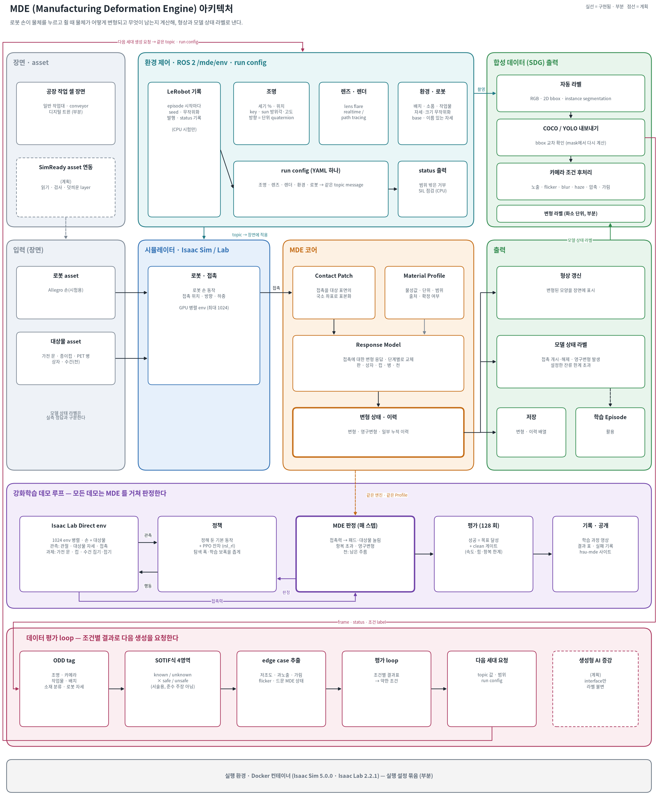

---
hide:
  - navigation
---

# Manufacturing Deformation Engine (MDE)

<span class="mde-badge">연구개발 진행 중</span> · **한성대학교 PARC Lab** · 기준일 2026-11-19

MDE는 로봇이 물체를 **누르고 쥐고 집을 때, 물체가 얼마나 눌리고 손을 뗀 뒤 무엇이 남는지**를 계산하는 시뮬레이션 엔진입니다.
NVIDIA Isaac Sim·Isaac Lab 안에서 로봇 손의 동작과 함께 매 스텝 돌며, 눌린 깊이·남은 자국·주름·늘어남과
금·찢김·항복 같은 소재 한계 초과를 냅니다. 소재는 Material Profile 파일로 바꾸므로, 같은 동작에서 소재만 바꿔 결과를 비교할 수 있습니다.
이 사이트는 지금까지의 **시뮬레이션 실험 결과**(영상·이미지·접촉력·관절 토크·강화학습 평가)를 공개합니다.

<video class="mde-video" src="media/cup-quick.mp4" poster="media/cup-quick.jpg" controls muted loop playsinline></video>

<p style="text-align:center"><small><b>대표 데모</b> — Allegro Hand가 종이컵을 빠르게 쥐고 들었다가 놓쳐 떨어뜨리는 4.8 s 장면(실제 시간 재생). 스텝마다 계산 시간을 함께 기록했습니다 → <a href="demo/">대표 데모</a></small></p>

## MDE가 필요한 이유

물리 엔진(PhysX)은 로봇 손과 물체가 **어떻게 움직이고 얼마의 힘이 걸리는지**를 계산합니다. 하지만 강체 접촉만으로는
그 힘에 물체가 **눌렸는지, 접혔는지, 금이 갔는지, 자국이 남았는지**를 알 수 없습니다. 그래서 「들어 올렸다」는 판정만으로는
물체를 망가뜨린 성공과 깨끗한 성공을 구분하지 못합니다.

MDE는 물리 엔진이 낸 접촉을 받아 소재별로 변형과 남는 상태를 계산하고, 그 값으로 성공·실패를 판정합니다.
이 사이트의 결과에서 그 차이가 드러난 예입니다.

| 과제 | 자세·동작만 본 판정 | MDE로 본 판정 |
|---|---|---|
| [펜 쥐기](pen-grasp.md) | 학습 ②(학습 ①을 이어 학습)는 자세 성공 126/128 | 펜을 약 15 N으로 쥐어 고무 그립에 자국 — MDE 기준 성공 **0/128**(손끝 반경 12 mm 가정 판정) |
| [달걀 집기(옆으로 눕힘)](rl-grasp.md) | 처음 학습한 정책이 126/128회 들어 올림 | 31회(24 %)에서 껍데기에 금이 갈 만큼 누름 → MDE 판정을 반영해 다시 학습해 금 1/128회(0.8 %) |
| [수건 접기](towel.md) | 손끝 센서 하중 곡선: 두 경우가 거의 같음(집기를 고치기 전 동작) | 접힘 오차 5.2 mm(성공) 대 32 mm(실패), 남은 주름 차이 |

손에 붙은 센서로는 물체 쪽의 상태(어디를 집었는지, 접힘 정렬, 늘어남, 남은 주름·자국)를 읽을 수 없습니다.
MDE는 그 값을 시뮬레이션 안에서 내 주므로, 강화학습의 판정과 학습 데이터의 라벨로 쓸 수 있습니다.
범용 물리 엔진과 MDE의 역할 차이는 [NVIDIA Newton과 비교](newton.md)에 정리했습니다.

## 동작 구조

[](images/mde-architecture.png)

<p style="text-align:center"><small><b>MDE 아키텍처</b> — 위: 시뮬레이터의 접촉이 Contact Patch로 표본화되고, Material Profile과 Response Model을 거쳐 변형 상태·이력이 된 뒤 형상 갱신과 모델 상태 라벨로 나갑니다. 아래: 강화학습 데모도 같은 엔진으로 매 스텝 판정합니다. 클릭하면 원본 크기로 볼 수 있습니다.</small></p>

1. **접촉 받기** — 물리 엔진이 매 스텝 낸 접촉 위치·방향·하중을 대상 표면의 **Contact Patch**로 표본화합니다.
2. **소재 응답 계산** — **Material Profile**(값마다 단위·허용 범위·출처·확정 여부를 함께 보관)과 **Response Model**이 접촉에 대한 변형을 계산합니다.
   Response Model은 대상(패드·컵 벽·병·천 등)과 개발 단계에 따라 바꿔 씁니다.
3. **상태와 이력 쌓기** — 눌린 깊이, 손을 뗀 뒤 남은 자국, 누적 이력을 변형 상태로 보관합니다.
4. **내보내기** — 변형된 형상과 **모델 상태 라벨**(접촉 개시·해제, 모델상 영구변형 발생, 설정한 한계 초과)을 냅니다.
   강화학습에서는 이 값으로 매 스텝 판정합니다.

- 소재 차이는 코드가 아니라 **Profile 파일 교체**로 만듭니다([소재별 손가락 가압](materials.md)).
- 모델 상태 라벨은 시뮬레이션 모델이 낸 값이며, 실물 시편으로 확인한 정답이 아닙니다.
- 강화학습 데모에서 구슬·달걀·펜 같은 물체는 물리 엔진에서 강체로 움직이고, MDE는 그 접촉력으로 눌림·자국·한계 초과를 판정합니다.
  수건은 MDE 천 모델이 모양까지 직접 계산합니다.

## 지금까지의 결과

모든 결과는 시뮬레이션이며, 로봇 손은 Isaac Sim 5.0에 포함된 Allegro Hand(Wonik Robotics) 모델입니다. 자세한 조건·영상·데이터와 한계는 각 페이지에 있습니다.

### 접촉·변형 실험

| 실험 | 한 줄 결과 |
|---|---|
| [대표 데모 — 빠르게 쥐었다 놓치기](demo.md) | 1/30 s 스텝으로 쥐기·들기·놓치기·낙하. 손이 컵에 닿아 있는 동안 스텝당 99–143 ms(평균)로 **아직 실시간(33 ms)이 아님**. CSV |
| [소재별 손가락 가압](materials.md) | 같은 손·같은 동작으로 소재 5종. 눌린 깊이 0.8–4.4 mm, 손을 뗀 뒤 남은 자국은 실리콘·엘라스토머 0 mm부터 점토 4.1 mm까지 |
| [종이컵 쥐기](cup.md) | 0.10 N·m로 쥐면 접촉력 합 16.8 N·테두리 4.2 mm, 0.35 N·m로 꽉 쥐면 70.0 N·8.4 mm, 놓으면 원래 모양. 컵 벽은 탄성만 표현 |
| [플라스틱 컵 쥐기](plastic-cup.md) | PET 16 oz 빈 컵 5.4 N·1.3 mm, 꽉 쥐면 10.6 N·3.4 mm. 물 1/3·2/3, 컵 크기 9·16·20·24 oz 비교. 옆벽 강성은 문헌 범위의 추정값. CSV |
| [PET 물병 쥐기](bottle.md) | 500 ml 생수병 다섯 경우. 마개를 닫으면 병 안 압력이 1.9 kPa까지 오르고 벽 변위 최대가 13 % 작음(차이가 모두 마개 때문은 아님). CSV |
| [데모 영상](videos.md) | 컵·물병 13개 실험을 매 스텝 다시 찍은 영상(장면 + 그래프, 네 방향, 회전 카메라, 단계 맞춤 비교), 강화학습 병렬 학습, 냉장고 문 여닫기 |
| [추정값·힘 점검](check.md) | 추정값(옆벽 강성·벽 두께·질량·마찰)을 공개 문헌과 대조해 고치고 13개 실험을 다시 계산한 전후 비교와 남은 한계 |
| [관절 토크](torque.md) | 종이컵 쥐기와 대표 데모의 관절 토크(접촉력에서 계산한 값). 종이컵 꽉 쥐기는 순간 최대 0.80 N·m로 Allegro Hand 한계 0.7 N·m를 3스텝 넘음. CSV |
| [NVIDIA Newton과 비교](newton.md) | 오픈소스 GPU 물리 엔진 Newton(v1.7.0)과 역할·대상·영구 변형·찢김 판정·연동 방식 비교. Newton은 움직임과 힘, MDE는 물체에 남는 것 |

### Mission — 강화학습

Allegro Hand가 과제를 강화학습(PPO)으로 배운 결과입니다. 같은 장면 256–2048개를 GPU 한 장(RTX 5080 16 GB)에서 동시에 돌려 학습하고,
정책을 고정해 128회(일부 표는 64·256·1024회) 평가했습니다. 과제마다 seed 1개로 학습한 결과이며, 보상 구성은 공개하지 않습니다.
성공했지만 인정하지 않은 결과(튕겨 열기·내던지기 등)와 실패한 학습도 영상과 원인을 함께 공개합니다.

| 과제 | 한 줄 결과 | MDE가 판정한 것 |
|---|---|---|
| [구슬·달걀·젤리 집기](rl-grasp.md) | 받침 위 구슬 128/128·달걀 127/128(금 0회). 탁자 위 구슬 127/128, 눕힌 달걀 128/128(금 0.8 %), 젤리 128/128(찢어짐 1.6 %) | 물체의 눌림·자국, 달걀 금·젤리 찢어짐 |
| [수건 접기](towel.md) | 1번 접기 127/128회 1.37 s(정해 둔 동작 3.42 s), 가장 빠른 1번 접기 128/128회 0.87 s, 찢김 0회. 2번 접기는 고친 집기로 아직 못 함 | 수건 모양, 집은 자리, 접힘 오차, 늘어남·찢김, 남은 주름 |
| [수건 집기 — 뭉툭한 손끝](towel-pick.md) | 집는 자리·방법을 정하지 않고 학습. 성공 85 %, 흔들어도 유지 88 %, 끝단 15 mm 안에서 집기 71 %(5 %에서), 찢김 15 %. 여러 손가락 집기는 여섯 번 학습해 모두 한 쌍으로 끝남 | 천이 두 패드 사이에 실제로 끼었는지, 늘어남·찢김 |
| [가전 문 열기](rl-door.md) | 막대 손잡이로 냉장고·오븐형 전자레인지·식기세척기·드럼세탁기 128·128·128·124/128(스크립트 2·23·123·14). 손잡이 없이 문 틈으로: 드럼세탁기 128/128, 오븐형 전자레인지 0/128 | 손끝 패드 눌림·영구변형·항복, 냉장고 문 패킹 |
| [펜 돌리기 (일시 중단)](pen-spin.md) | 세 번 학습 모두 실패(회전수 중앙값 0.25·0.18·0.14바퀴). 조건 10가지 점검에서도 4분의 1바퀴 벽을 넘지 못해 중단 | 손끝 패드·펜 그립 슬리브 눌림(같은 시작 방향에서는 자국 없음) |
| [글씨 쓰기 1단계 — 펜 쥐기 (진행 중)](pen-grasp.md) | 세 손가락으로 펜을 쥐고 펜 끝을 종이에 0.5–2 N으로 2초. 자세 성공 126/128, MDE 기준 성공 **126/128**. 받침에서 집어 올리기는 아직 안 됨 | 펜 고무 그립에 남은 자국, 손끝 패드 항복 |

!!! note "정정 기록"
    - **2026-10-25** — 추정값을 문헌과 대조해 PET 컵·물병 물성과 힘 계산을 고치고 13개 실험을 모두 다시 계산했습니다([추정값·힘 점검](check.md)).
    - **2026-10-31** — 수건 집기 판정의 결함(잡은 동안 두 손끝이 실제로는 떨어져 있었음)을 고쳐 다시 학습했고, 고친 집기로 아직 못 한 2번 접기 결과는 거둬들였습니다([수건 접기](towel.md)).
    - **2026-11-05** — 손끝 곡률 반경 가정값 12 mm를 손끝 3D 모델 실측값 6.92 mm로 바로잡아 다시 판정했습니다. 펜 쥐기는 처음 공개한 128/128이
      116/128이 되어 다시 학습했고(126/128), 가전 문 열기는 막대 손잡이 절의 접촉력 60 N 상한도 4000 N으로 바로잡아 다시 판정했고, 연 횟수는 같고 패드 항복이 늘었습니다([펜 쥐기](pen-grasp.md) · [가전 문 열기](rl-door.md) · [펜 돌리기](pen-spin.md) 맨 위).

## ROS 2 환경 제어

시뮬레이션 장면의 환경 조건을 **ROS 2 topic**으로 바꿉니다. 같은 동작을 조명·배치·시점이 다른 조건에서 반복해 데이터를 모으고
(domain randomization), 그 장면을 정답 라벨과 함께 촬영합니다(synthetic data). 데모용 장면으로 공장 작업 셀(작업대·conveyor·부품
상자가 있는 산업 건물)을 구성했습니다.

| 분류 | Topic (`/mde/env/…`) | 제어 내용 |
|---|---|---|
| 조명 | `lights/{ceiling,key,sun}/enable` · `intensity` · `color_temperature`, `lights/{ceiling,key}/color` | 천장 조명·작업대 위 spot 조명·외광의 켜기/끄기, 세기(기준 대비 %), 색온도(K), 색(천장·spot) |
| 조명 위치·모양 | `lights/key/pose` · `radius`, `lights/sun/pose` · `azimuth_elevation` · `angular_size` | spot 조명의 위치·방향·크기, 햇빛의 방위각·고도 |
| 카메라 | `camera/pose`, `camera/lens_flare/*` | 촬영 시점, lens flare(조리개 날 수·F 값·초점거리 등) |
| 렌더 | `render/mode` | 실시간 / path tracing |
| 배치 | `layout/select`, `layout/table/pose`, `layout/conveyor/pose`, `clutter/enable` | 작업 셀 배치 preset, 작업대·conveyor 위치, 주변 부품 표시 |
| 무작위화 | `randomize/seed` · `clutter` · `lights` · `materials` · `camera` · `all` | 부품 배치·크기, 조명 조건, 표시 재질, 카메라 시점(seed로 재현) |
| 촬영 | `capture/trigger` | N장 촬영, 장마다 새 시점. RGB·2D bounding box·instance/semantic segmentation 자동 라벨 |
| 상태 | `status` (출력) | 메시지마다 적용 결과·거부 사유(JSON) |

- 모든 입력은 허용 범위를 검사하며, 범위를 벗어난 메시지는 적용하지 않고 `status`로 사유를 돌려줍니다.
- 무작위화는 화면에 보이는 조건만 바꿉니다. 접촉·변형 계산에 쓰는 소재 물성값은 바뀌지 않습니다.
- ROS 2 Humble·Jazzy에서 정의가 같은 표준 메시지 타입(`std_msgs`, `geometry_msgs`)만 사용합니다.
- 장면 안에서 같은 메시지로 조명·무작위화·촬영이 적용되는 것을 확인했습니다. ROS 2 네트워크로 보내 적용하는 시험은 아직 하지 않았습니다.

```bash
ros2 topic pub --once /mde/env/lights/ceiling/intensity std_msgs/msg/Float32 "{data: 50.0}"
ros2 topic pub --once /mde/env/randomize/all std_msgs/msg/Empty "{}"
ros2 topic pub --once /mde/env/capture/trigger std_msgs/msg/Int32 "{data: 100}"
```

## 검증과 재현

- **코어 시험** — 변형 계산 코어는 GPU 없이 단위 시험으로 확인합니다. 시험이 결함을 실제로 잡는지는 코드에 일부러 결함을 넣는
  결함 주입(mutation) 시험으로 따로 확인합니다.
- **같은 실행에서 나온 수치** — 페이지의 표·그래프·영상 속 수치와 내려받는 CSV는 같은 실행에서 나왔습니다.
- **문헌 대조** — 추정값은 공개 문헌·특허의 시험값과 대조하고, 범위를 벗어난 값은 고쳐 다시 계산합니다([추정값·힘 점검](check.md)).
- **판정을 엄격하게** — 강화학습은 정책을 고정해 평가합니다. 판정의 허점을 이용한 동작(펜을 기울여 굴려 회전수 부풀리기, 문을 튕기거나
  내던져 열기 등)은 찾아내 판정을 고친 뒤 다시 학습하고, 그 전 결과는 성공으로 세지 않습니다.
- **정정은 공개** — 결함을 찾으면 페이지 맨 위에 정정 상자를 두고 이전 값과 바뀐 값을 함께 적습니다(위 「정정 기록」).
- **재현성의 한계** — 지금 공개한 강화학습 결과는 과제마다 seed 1개로 한 번 학습한 것입니다. 다시 학습하면 결과가 달라질 수 있습니다.

!!! warning "결과를 읽을 때"
    - 모든 결과는 **시뮬레이션**입니다. 실물 시편·실제 로봇으로 시험한 값이 아닙니다.
    - 소재 물성과 마찰·질량은 문헌·제품 자료에서 잡은 **잠정값·가정값**이며 실측 보정 전입니다. PET 컵·물병의 옆벽 강성도 추정값입니다. 특정 제품의 성능 예측으로 쓰지 마십시오.
    - 관절 토크는 관절 센서로 잰 값이 아니라 시뮬레이션의 접촉력에서 **계산한 값**입니다(소재 가압은 법선력만, 컵·물병은 들고 있는 동안 무게를 받치는 마찰도 포함).
    - 컵·물병 꽉 쥐기에서 손가락 하나의 힘은 Allegro Hand 손끝 능력(약 7–15 N, 추정)을 넘습니다. 컵·병 벽은 탄성만 표현해 주름·찌그러짐이 남지 않습니다.
    - 강화학습 데모의 물체는 물리 엔진에서 강체입니다. MDE가 계산한 눌림이 손의 움직임에 되먹임되지는 않습니다.
    - 손이 물체에 닿아 있는 동안은 아직 실시간으로 돌지 않습니다([대표 데모](demo.md)).

## 설치와 예제 실행 { #설치와-예제-실행 }

MDE 소스는 공개하지 않습니다. **GitHub 저장소 주소는 [kblee@hansung.ac.kr](mailto:kblee@hansung.ac.kr)로 요청해
허가받은 분들에게만 알려 드립니다.** 요청 메일에 소속, 사용 목적, GitHub 계정을 적어 주시면, 허가 시 저장소 초대와 함께
상세 설치 가이드(저장소의 `docs/INSTALL.md`)를 안내합니다. 받은 소스와 문서는 제3자에게 전달하거나 공개하지 않는 조건입니다.

| 항목 | 필요한 환경 |
|---|---|
| OS | Ubuntu 22.04 |
| GPU | NVIDIA RTX 계열, VRAM 12 GB 이상 (검증: RTX 5080 16 GB) |
| 소프트웨어 | NVIDIA driver, Docker + NVIDIA Container Toolkit, Python 3.10 이상 |
| 시뮬레이터 | NVIDIA Isaac Sim 5.0.0 · Isaac Lab 2.2.1 — host에 설치하지 않고 Docker 컨테이너로 실행 |
| 디스크 | 100 GB 이상 (컨테이너 이미지 약 50 GB) |

1. **Host 준비** — NVIDIA driver, Docker, NVIDIA Container Toolkit을 설치하고 컨테이너 안에서 GPU가 보이는지 확인합니다.
2. **코어 설치** — 저장소를 받아 Python 패키지로 설치하고 시험을 돌립니다. 코어 엔진은 GPU 없이 동작합니다.
3. **Isaac 준비** — Isaac Sim 5.0.0 이미지를 받고, 로봇 손 모델을 한 번 내려받고, Isaac Lab 이미지를 만듭니다(1회, 네트워크 필요).

예제를 순서대로 실행하면 설치의 각 층을 하나씩 확인할 수 있습니다. 기대 결과는 저장소에 함께 들어 있습니다.

| 예제 | GPU | 이 사이트의 해당 결과 |
|---|---|---|
| 패드 반복 가압 (코어 엔진만) | 불필요 | — |
| PET 물병 쥐기 (Isaac Sim 장면) | 필요 | [PET 물병 쥐기](bottle.md) |
| 손가락 가압 · 소재 비교 | 필요 | [소재별 손가락 가압](materials.md) |
| 냉장고 문 여닫기 | 필요 | [데모 영상](videos.md) |
| 강화학습 — 유리구슬 집기 | 필요 | [구슬·달걀·젤리 집기](rl-grasp.md) |
| 강화학습 — 수건 접기 (1024개 병렬 환경) | 필요 | [수건 접기](towel.md) |

강화학습 예제는 학습부터 시작합니다(정책 하나에 약 10–60분). 학습·평가·영상 만들기를 각각 명령 한 줄로 실행합니다.

## 개발 단계와 다음 계획

| 단계 | 범위 | 현황 |
|---|---|---|
| v0 기준선 | 하중–변형 기준 모델 재현 | 완료 |
| v1 탄성·항복 | 가압·파지 시의 변형과 항복 | 모델 구현, 실측 보정 준비 |
| v2 소성·잔류·구조 | 영구변형, 얇은 벽 용기 | 일부 구현 |
| v3 이력·마모 | 장기 사용 상태·마모·공차 변화 | 계획 |

다음 계획(각 페이지에 적은 내용):

- PET 컵·물병 옆벽 강성을 실물로 재고, 손끝 힘이 Allegro Hand 능력 안에 들도록 꽉 쥐기 설정을 다시 봅니다([추정값·힘 점검](check.md)).
- 겹친 천을 집는 것을 천 모델이 다루도록 바꾼 뒤 수건 2번 접기를 다시 학습합니다([수건 접기](towel.md)).
- 글씨 쓰기는 펜을 손에 놓아 준 상태에서 이어 갑니다. 받침에서 집어 올리기는 보류 중입니다([펜 쥐기](pen-grasp.md)).
- Isaac Lab 3.0의 Newton 물리 백엔드 위에서 같은 판정을 돌리는 것을 검토합니다(아직 시험하지 않음, [Newton과 비교](newton.md)).

## 연계와 문의

MDE는 [Robot RFM 데이터팩토리 과제](https://parclab-hsu.github.io/projects/manufacturing-data-factory-rfm/)의
Manufacturing Deformation Engine 개발과 연계됩니다. 연구실 소개와 다른 과제는 [PARC Lab 홈페이지](https://parclab-hsu.github.io/)에 있습니다.
문의: [kblee@hansung.ac.kr](mailto:kblee@hansung.ac.kr)

<small>사용한 도구: NVIDIA Isaac Sim 5.0.0 · Isaac Lab 2.2.1(PhysX), Allegro Hand(Wonik Robotics) 시뮬레이션 모델. 공장 작업 셀 장면은 Isaac Sim 기본 제공 asset으로 구성했습니다.</small>
