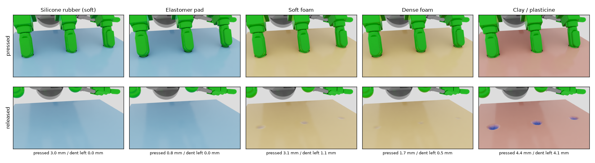
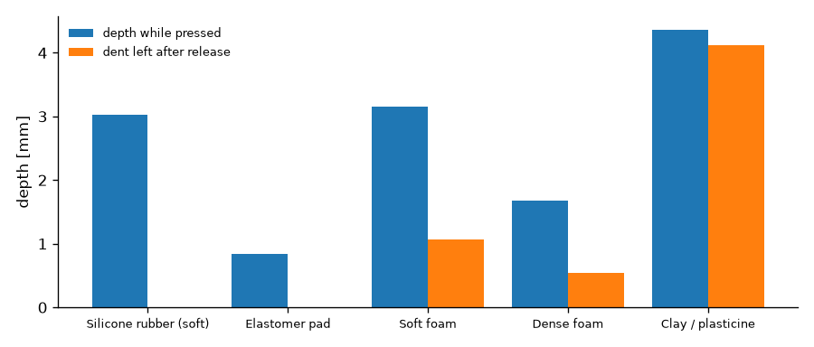

# 소재별 손가락 가압

Allegro Hand가 160 × 160 mm 패드를 검지·중지·약지로 세 번 눌렀다 떼는 장면입니다. 손과 동작은 그대로 두고
**패드 소재 Profile만 바꿔** 다섯 번 실행했습니다. 패드 색이 짙을수록 깊게 눌린 곳입니다. 기준: 2026-10-22, Isaac Sim 5.0.0, 120 Hz.

<figure><video src="../media/fingers-silicone.mp4" poster="../media/fingers-silicone.jpg" controls muted loop playsinline></video><figcaption>실리콘 고무(연질)</figcaption></figure>
<figure><video src="../media/fingers-elastomer.mp4" poster="../media/fingers-elastomer.jpg" controls muted loop playsinline></video><figcaption>엘라스토머 패드</figcaption></figure>
<figure><video src="../media/fingers-soft-foam.mp4" poster="../media/fingers-soft-foam.jpg" controls muted loop playsinline></video><figcaption>연질 폼</figcaption></figure>
<figure><video src="../media/fingers-dense-foam.mp4" poster="../media/fingers-dense-foam.jpg" controls muted loop playsinline></video><figcaption>고밀도 폼</figcaption></figure>
<figure><video src="../media/fingers-clay.mp4" poster="../media/fingers-clay.jpg" controls muted loop playsinline></video><figcaption>점토</figcaption></figure>
<figure><video src="../media/palm-clay.mp4" poster="../media/palm-clay.jpg" controls muted loop playsinline></video><figcaption>점토 — 손바닥으로 누르기(샘플)</figcaption></figure>

<figure markdown>
  { loading=lazy }
  <figcaption>위: 누르고 있는 상태, 아래: 손가락을 뗀 뒤</figcaption>
</figure>

<figure markdown>
  { loading=lazy }
  <figcaption>소재별 최대 눌림 깊이(청)와 손을 뗀 뒤 남은 자국(주황)</figcaption>
</figure>

| 소재 Profile | 계열 | 눌린 깊이 | 뗀 뒤 남은 자국 | 거동 |
|---|---|---|---|---|
| 실리콘 고무(연질) | 탄성체 | 3.0 mm | 0.0 mm | 깊게 눌리고 완전히 복원 |
| 엘라스토머 패드 | 탄성체 | 0.8 mm | 0.0 mm | 단단해 얕게 눌리고 복원 |
| 연질 폼 | 폴리머 폼 | 3.1 mm | 1.1 mm | 일부 영구변형 |
| 고밀도 폼 | 폴리머 폼 | 1.7 mm | 0.5 mm | 일부 영구변형 |
| 점토 | 점토 | 4.4 mm | 4.1 mm | 대부분 영구변형 |

- 소재 차이는 코드가 아니라 **Profile 파일 교체**만으로 만들어집니다.
- 폼·점토에서는 영구변형 시작과 설정한 자국 한계 초과가 **이벤트로 기록**됩니다(학습 데이터 라벨용). 실물 시편의 판정 결과는 아닙니다.
- 손가락은 목표 각도까지 움직이는 위치 제어라 소재가 달라도 손가락 힘은 비슷하고(손가락당 약 4–7 N), 차이는 눌린 깊이와 남은 자국에 드러납니다.
- 손바닥 누르기 영상은 동작 샘플입니다. 손바닥·엄지 배치의 제약으로 이 장면의 수치는 비교표에 넣지 않았습니다.
