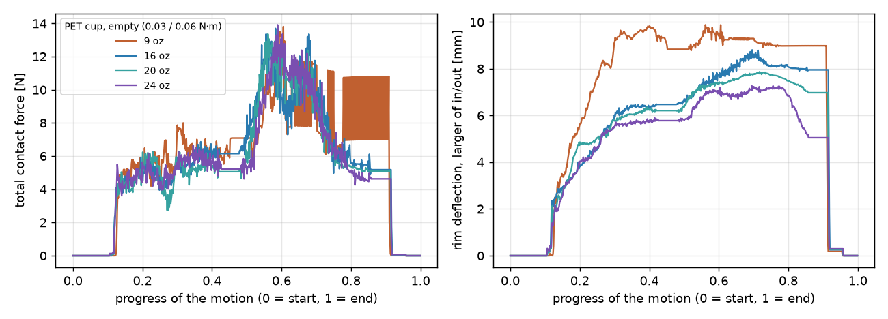
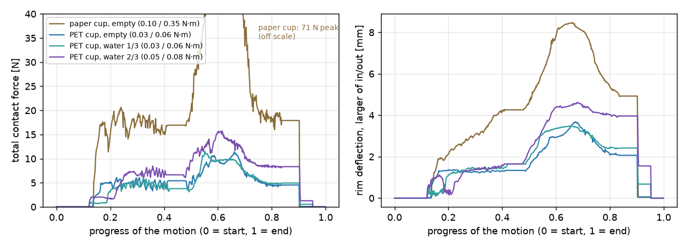

# 플라스틱 컵 쥐기

[종이컵 쥐기](cup.md)와 같은 동작으로 투명 **PET 16 oz 냉음료 컵**(윗지름 98 mm, 아랫지름 58 mm, 높이 115 mm, 벽 두께 0.25 mm)을
쥡니다. 옆에서 감싸 쥐고, 80 mm 들어 올려 더 세게 쥐었다가 풀고, 내려놓습니다. **빈 컵, 물 1/3, 물 2/3** 세 경우와 **컵 크기 네 가지**(9 / 16 / 20 / 24 oz)를 비교합니다.
500 ml 물병은 [PET 물병 쥐기](bottle.md)에 있습니다.
PET 컵은 종이컵보다 훨씬 무르기 때문에 관절 토크를 낮췄습니다(종이컵은 0.10 / 0.35 N·m).
컵 벽의 색은 변형 방향(적색: 바깥으로, 청색: 안쪽으로)입니다. 기준: 2026-10-24, Isaac Sim 5.0.0.

## 빈 컵 (쥐기 0.03 N·m, 꽉 쥐기 0.06 N·m)

<video class="mde-video" src="../media/pet-cup-grasp.mp4" poster="../media/pet-cup-grasp.jpg" controls muted loop playsinline></video>

<figure><figcaption>쥐었을 때 (0.03 N·m)</figcaption></figure>
<figure><figcaption>꽉 쥐었을 때 (0.06 N·m)</figcaption></figure>
<figure><figcaption>위에서 본 모습 — 테두리가 타원이 된다</figcaption></figure>
<figure><figcaption>0.03 N·m로 되돌림 — 찌그러진 모양이 거의 그대로 남는다</figcaption></figure>

## 물 1/3 — 126 ml, 컵과 물 138 g (쥐기 0.03 N·m, 꽉 쥐기 0.06 N·m)

<video class="mde-video" src="../media/pet-water13-grasp.mp4" poster="../media/pet-water13-grasp.jpg" controls muted loop playsinline></video>

<figure><figcaption>쥐기 전 — 물 높이 38 mm</figcaption></figure>
<figure><figcaption>80 mm 들어 올림</figcaption></figure>
<figure><figcaption>꽉 쥐었을 때 위에서</figcaption></figure>

## 물 2/3 — 310 ml, 컵과 물 322 g (쥐기 0.05 N·m, 꽉 쥐기 0.08 N·m)

빈 컵과 같은 0.03 N·m로는 들지 못합니다. 쥐는 힘 4.5 N에 마찰계수 0.5를 곱한 2.2 N이 무게 3.2 N보다 작습니다.
그래서 0.05 N·m로 올려 쥐었습니다.

<video class="mde-video" src="../media/pet-water23-grasp.mp4" poster="../media/pet-water23-grasp.jpg" controls muted loop playsinline></video>

<figure><figcaption>쥐기 전 — 물 높이 77 mm</figcaption></figure>
<figure><figcaption>80 mm 들어 올림 (0.05 N·m)</figcaption></figure>
<figure><figcaption>꽉 쥐었을 때 위에서 (0.08 N·m)</figcaption></figure>

## 결과

| | 빈 컵 | 물 1/3 | 물 2/3 |
|---|---|---|---|
| 컵과 물의 무게 | 12 g (0.12 N) | 138 g (1.36 N) | 322 g (3.16 N) |
| 쥐기 / 꽉 쥐기 설정 | 0.03 / 0.06 N·m | 0.03 / 0.06 N·m | 0.05 / 0.08 N·m |
| 쥐었을 때 접촉력 · 테두리 변형 | 6.5 N · 6.5 mm | 5.4 N · 6.2 mm | 8.6 N · 7.2 mm |
| 들고 있을 때 접촉력 | 6.2 N | 5.9 N | 7.8 N |
| 꽉 쥐었을 때 접촉력 · 테두리 변형 | 10.2 N · 8.3 mm | 12.4 N · 8.0 mm | 14.6 N · 8.8 mm |
| 되돌렸을 때 테두리 변형 | 7.9 mm | 7.6 mm | 9.0 mm |
| 마찰 여유 (들고 있는 동안 최소) | 19.7배 | 1.85배 | **1.09배** |
| 관절 토크 최대 | 0.17 N·m | 0.17 N·m | 0.20 N·m |

- 마찰 여유는 손가락이 마찰로 버틸 수 있는 힘(마찰계수 0.5 × 접촉력)을 컵과 물의 무게로 나눈 값입니다. 1보다 작으면 미끄러집니다.
  물 2/3에서는 0.05 N·m로도 여유가 1.09배밖에 되지 않습니다.
- 관절 토크에는 손가락 마찰이 컵과 물의 무게를 받치는 힘이 들어 있습니다.
- 꽉 쥐어도 수면 높이는 0.1 mm 이하로만 변합니다. 컵이 타원으로 찌그러져도 단면적은 거의 줄지 않기 때문입니다.

## 컵 크기 — 9 / 16 / 20 / 24 oz (빈 컵, 쥐기 0.03 N·m, 꽉 쥐기 0.06 N·m)

윗지름이 같은 계열(95–98 mm)의 PET 컵 네 가지를 같은 토크로 쥡니다. 벽 두께와 소재는 16 oz와 같고, 치수만 다릅니다.

| | 9 oz | 16 oz | 20 oz | 24 oz |
|---|---|---|---|---|
| 윗지름 / 아랫지름 / 높이 | 95 / 57 / 83 mm | 98 / 58 / 115 mm | 95 / 60 / 140 mm | 95 / 64 / 165 mm |
| 컵 무게 (추정) | 8.9 g | 12 g | 13.8 g | 16.4 g |
| 쥐는 높이 (탁자에서) | 40 mm | 75 mm | 91 mm | 107 mm |
| 지름을 6.35 mm 줄이는 힘 (추정) | 0.70 N | 0.72 N | 0.82 N | 0.84 N |
| 쥐었을 때 접촉력 · 테두리 변형 | 5.9 N · 9.0 mm | 6.5 N · 6.5 mm | 5.3 N · 6.3 mm | 5.5 N · 5.8 mm |
| 꽉 쥐었을 때 접촉력 · 테두리 변형 | 11.7 N · 9.3 mm | 10.2 N · 8.3 mm | 10.1 N · 7.7 mm | 10.8 N · 6.9 mm |
| 되돌렸을 때 테두리 변형 | 9.0 mm | 7.9 mm | 7.0 mm | 5.2 mm |
| 마찰 여유 (들고 있는 동안 최소) | 33배 | 19.7배 | 17.2배 | 13.2배 |
| 관절 토크 최대 | 0.26 N·m | 0.17 N·m | 0.16 N·m | 0.15 N·m |

<figure><figcaption>9 oz — 꽉 쥐었을 때 위에서</figcaption></figure>
<figure><figcaption>20 oz — 꽉 쥐었을 때 위에서</figcaption></figure>
<figure><figcaption>24 oz — 꽉 쥐었을 때 위에서</figcaption></figure>

<figure><video class="mde-video" src="../media/pet-9oz-grasp.mp4" poster="../media/pet-9oz-grasp.jpg" controls muted loop playsinline></video><figcaption>9 oz</figcaption></figure>
<figure><video class="mde-video" src="../media/pet-20oz-grasp.mp4" poster="../media/pet-20oz-grasp.jpg" controls muted loop playsinline></video><figcaption>20 oz</figcaption></figure>
<figure><video class="mde-video" src="../media/pet-24oz-grasp.mp4" poster="../media/pet-24oz-grasp.jpg" controls muted loop playsinline></video><figcaption>24 oz</figcaption></figure>

{ loading=lazy }

- 같은 토크로 쥐면 접촉력은 크기와 관계없이 비슷하고(5–7 N), **작은 컵일수록 테두리가 더 찌그러집니다**. 9 oz는 키가 낮아
  손가락이 테두리 가까이를 쥐게 됩니다.
- 9 oz는 쥐는 높이를 40 / 47 / 54 / 60 mm로 바꿔 보았습니다. 47 mm는 관절 토크가 한 스텝 크게 튀었고, 54 mm는 들어 올리지 못했으며,
  60 mm는 검지가 테두리를 넘어갔습니다. 그래서 40 mm로 쥐었습니다.
- 9 oz는 들어 올린 뒤 약지가 컵 바닥 아래로 내려갑니다. 컵 바닥과 손가락의 접촉은 계산하지 않습니다.
- 9 oz는 내려놓는 동안 접촉력이 스텝마다 7.0 N과 10.8 N을 오갑니다(그래프 오른쪽의 띠). 원인은 아직 확인하지 않았습니다.

데이터: [9 oz](data/pet-9oz-grasp.csv) · [16 oz](data/pet-cup-grasp.csv) · [20 oz](data/pet-20oz-grasp.csv) · [24 oz](data/pet-24oz-grasp.csv)

## 종이컵과 비교

{ loading=lazy }

| | 종이컵 16 oz (빈 컵) | PET 컵 16 oz (빈 컵) |
|---|---|---|
| 지름을 6.35 mm 줄이는 힘 (높이의 2/3 지점) | 4.4 N (시판 컵 시험값 3.5–5.3 N에 맞춤) | 0.7 N (추정값, 0.3–1.9 N) |
| 쥐었을 때 접촉력 / 테두리 | 17.2 N / 5.6 mm | 6.5 N / 6.5 mm |
| 꽉 쥐었을 때 접촉력 / 테두리 | 76.8 N / 9.1 mm | 10.2 N / 8.3 mm |
| 되돌렸을 때 테두리 | 4.2 mm | 7.9 mm |

- PET 컵은 1/3 이하의 힘으로 종이컵보다 더 찌그러집니다.
- 힘을 되돌려도 PET 컵은 찌그러진 모양이 거의 남습니다. 무른 컵은 적은 힘으로도 그 모양을 유지할 수 있어, 쥐는 토크가 설정값
  아래로 내려가면 손가락이 더 물러나지 않기 때문입니다.

데이터(스텝·단계·설정·접촉력 합과 손가락별·테두리 변형·컵 높이·마찰이 받친 무게·수면 높이·관절 16개 토크):
[빈 컵](data/pet-cup-grasp.csv) · [물 1/3](data/pet-water13-grasp.csv) · [물 2/3](data/pet-water23-grasp.csv)

!!! warning "한계"
    - **PET 컵의 옆벽 강성은 실측값이 아닙니다.** 컵 치수·벽 두께·PET 탄성계수에서 계산한 추정값이며, 그 범위만 해도 6배 차이가
      납니다. 종이컵은 시판 컵의 시험값에 맞췄습니다.
    - 컵 벽은 **탄성만** 표현합니다. 벽 변위 8 mm 이상은 모델이 정확한 범위(약 3.4 mm)를 크게 넘는 외삽입니다. 실제 PET 컵은
      이 정도면 옆벽이 꺾이거나 찌그러진 채 남습니다.
    - 물은 무게로만 들어갑니다. 출렁임·관성은 없고, 컵은 기울지 않습니다. 들어 올린 뒤에는 미끄러짐을 다시 계산하지 않으므로,
      여유가 1보다 작아지는 설정은 결과로 쓰지 않았습니다.
    - 관절 토크는 관절 센서 값이 아니라 시뮬레이션의 접촉력에서 계산한 값입니다.
