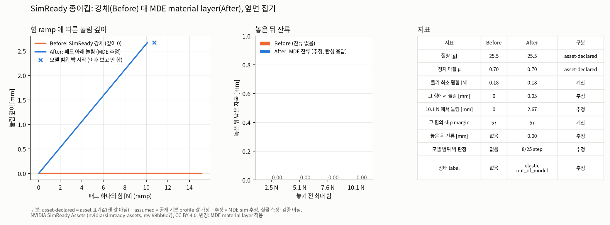
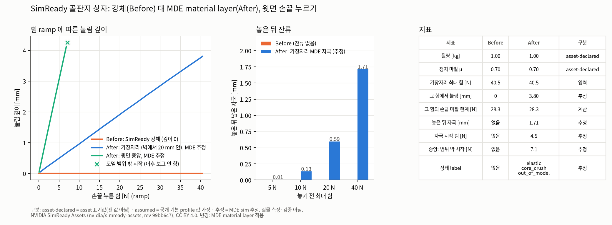

# SimReady asset 과 MDE

기준일 2026-11-28 · 상태 표기: 구현됨 구현했고 시험을 통과함 ·
부분 일부만 구현됨 · 계획 아직 구현하지 않음

이 페이지는 NVIDIA **SimReady** 규격을 설명하고, 공개 SimReady asset 네 개(종이컵·플라스틱 컵·커피컵·골판지 상자)를 읽어
MDE 의 공개 Material Profile 과 비교한 결과를 정리합니다. 연동 계획의 요약은 [MDE 소개 · 기능](features.md#simready)에 있습니다.

- 이 페이지의 분석은 **asset 파일을 읽어서 한 것**입니다. GPU 장면에서 asset 을 움직여 본 결과는 아직 없습니다.
- 네 asset 을 읽은 뒤 두 공개 pack 에서 asset 700개를 더 받아 같은 방식으로 읽었습니다. 그 요약은 [9절](#batch-700), MDE 가 SimReady asset 을
  가져올 때 지키는 규칙은 [10절](#import-rules)에 있습니다.
- MDE 의 값은 모두 **시뮬레이션 모델의 추정값**입니다. 실물 시편이나 실제 로봇으로 확인한 값이 아닙니다.

값 표기:

| 표기 | 뜻 |
|---|---|
| **asset 선언** | SimReady asset 파일에 적혀 있는 값. 실물을 잰 값이라는 보장이 없습니다 |
| **mesh 측정** | 우리가 asset 의 렌더 mesh 에서 잰 값. 실물이 아니라 3D 모델을 잰 것입니다 |
| **가정** | MDE Material Profile 의 값. 제품 카탈로그·문헌·특허 시험값에서 고른 잠정값이며 실측 보정 전입니다 |

## 1. SimReady 개요

**SimReady** 는 NVIDIA 가 정한 OpenUSD 기반 시뮬레이션용 asset 규격입니다
([NVIDIA 용어집: What Is SimReady?](https://www.nvidia.com/en-us/glossary/simready/)).
공개 사양과 검사 도구는 [SimReady Foundation](https://github.com/NVIDIA/simready-foundation)에 있습니다.

### 1.1 규격 구조

사양은 네 층으로 짜여 있습니다([SimReady Foundation 시작 안내](https://nvidia.github.io/simready-foundation/latest/guides/getting_started.html)).

| 층 | 뜻 | 예 |
|---|---|---|
| profile | 용도별로 묶은 이름·판 있는 규격 | `Robotics-Prop` (로봇이 다루는 소품) |
| feature | 사용 사례 하나에 필요한 요구 묶음. profile 마다 필수·선택이 정해짐 | 강체(Rigid Body), 쥐기(Grasp), 재질(Materials) |
| requirement | 지켜야 할 조건 하나 | 「강체에는 질량이 있어야 한다」 |
| rule | requirement 를 기계로 검사하는 규칙. ID 가 붙음 | `RB.007`, `AF.001` |

profile·feature·requirement 는 각각 따로 판 관리합니다. `Robotics-Prop` 에는 3.0.0·3.1.0·3.2.0·3.3.0·4.0.0·5.0.0 판이 있습니다.

### 1.2 단위·물리

- **단위·축.** Z 축이 위(Z-up), 길이 단위 1 m(`metersPerUnit = 1`)를 요구합니다. 물리가 있으면 질량 단위(`kilogramsPerUnit`)도 적습니다.
- **강체·질량.** 강체 feature 는 필수이고, 강체나 그 충돌 형상에 `physics:mass` 를 적어야 합니다.
- **마찰은 선택.** 마찰·반발(restitution)을 담는 물리 재질은 `Robotics-Prop` 에서 선택 feature(Grasp)에만 들어 있습니다.
  그래서 규격을 통과한 asset 이라도 마찰값이 없을 수 있습니다.
- **충돌 형상.** 물리 엔진(PhysX·Newton·MuJoCo)별로 runtime variant 를 두고, 엔진마다 충돌 형상 근사 방식을 따로 적을 수 있습니다.
- **변형은 없음.** 공개 사양에는 물체가 눌리거나 접히거나 자국이 남는 성질을 담는 항목이 없습니다. SimReady asset 은 **강체**로 움직이도록 만들어집니다.

### 1.3 재질 표시와 의미 라벨

- **화면용 재질.** UsdPreviewSurface(4.0.0부터 필수), MDL, OpenPBR 등.
- **센서용(non-visual) 재질 token.** 재질에 `omni:simready:nonvisual:base` 같은 token 을 붙여 `paper`·`plastic`·`cardboard` 처럼
  무엇으로 만들었는지를 센서 시뮬레이션용으로 표시합니다.
- **의미 라벨.** OpenUSD 의 `UsdSemantics` **LabelsAPI** 로 「무엇인지」「무엇으로 만들었는지」를 붙입니다.
  SimReady 는 물체 종류를 [Wikidata](https://www.wikidata.org/) Q-code(예: 종이컵 Q1131992)로 적는 관례를 씁니다
  ([SimReady 의미 라벨 안내](https://nvidia.github.io/simready-foundation/latest/guides/semantic_labels/semantic_labels.html)).
  예전 방식(SemanticsAPI)은 deprecated 이며, 같은 값을 LabelsAPI 로도 적어야 합니다.

### 1.4 검사 도구

- 공개 검사 도구 `simready-validate` 로 asset 이 어떤 profile·판을 만족하는지 확인합니다. 예:
  `simready-validate --profile Robotics-Prop --version 4.0.0 asset.usd`.
- 결과는 **판에 따라 달라집니다.** 같은 asset 이 한 판은 통과하고 다음 판은 실패할 수 있습니다(아래 3.1).
  그래서 결과를 적을 때는 도구 판과 profile 판을 함께 적어야 합니다.
- Isaac Sim 6.1 에는 같은 검사를 UI 에서 하는 메뉴가 있습니다([Isaac Sim 6.1 Asset Validation](https://docs.isaacsim.omniverse.nvidia.com/6.1.0/robot_setup/asset_validation.html)).

### 1.5 배포 경로와 라이선스

- SimReady asset 은 Hugging Face 의 SimReady dataset(예: NVIDIA 의 [nvidia/simready-assets](https://huggingface.co/datasets/nvidia/simready-assets))과
  NVIDIA [SimReady Central](https://docs.omniverse.nvidia.com/simready/latest/simready-central.html) 안내로 배포됩니다.
- 2026-11-28 에 확인한 Hugging Face SimReady dataset 은 대부분 **CC BY 4.0** 으로 표시되어 있습니다.
- 예전에 zip 묶음으로 배포된 asset pack 은 라이선스 조건을 원문으로 확인하지 못했습니다.
- 라이선스는 dataset 이나 pack 단위가 아니라 **asset 마다 확인**해야 합니다. asset 안의 metadata(`asset_license`)와 함께 들어 있는 라이선스 파일을 봅니다.

## 2. SimReady 와 MDE 의 역할

| | SimReady asset | MDE |
|---|---|---|
| 맡는 것 | 형상, 단위, 강체·질량, 충돌 형상, 마찰·반발(선택), 화면·센서용 재질, 의미 라벨 | 접촉으로 생기는 눌림, 손을 뗀 뒤 남는 자국, 한계 초과(금·찢김·항복) |
| 물리 엔진 안에서 | 강체로 움직임 | 물리 엔진을 대체하지 않음. 물리 엔진이 낸 접촉을 받아 계산 |
| 변형·잔류 parameter | 없음 | Material Profile 에 있음(값마다 단위·범위·상태·출처) |

- MDE 는 SimReady 를 **대체하지 않는 층**입니다. SimReady asset 은 그대로 두고, 그 위에 소재 응답과 남는 상태를 더합니다.
- 두 규격·도구의 우열을 비교하는 페이지가 아닙니다. 맡는 일이 다릅니다.

## 3. 첫 묶음 분석

대상: Hugging Face dataset `nvidia/simready-assets`, revision `99bb6c7`(2026-11-28 내려받음), asset 네 개.

| asset | 내용 |
|---|---|
| paper cup | 일회용 종이컵 |
| plastic cup | 둥근 사각 단면의 두꺼운 재사용 플라스틱 컵(일회용 얇은 컵이 아님) |
| coffee cup | 뚜껑과 sleeve 가 있는 테이크아웃 커피컵 asset. 몸통과 뚜껑이 별도 강체 |
| cardboard box | 테이프가 붙은 골판지 상자 |

네 asset 모두 CC BY 4.0 이고, 라이선스 파일이 함께 들어 있습니다. asset 파일은 읽기만 했고 고치지 않았습니다.
이 사이트에 asset 파일·형상·화면을 다시 올리지 않았습니다.

### 3.1 검사 결과

`simready-validate` 2026.10.0, `--profile Robotics-Prop`.

| asset | 3.1.0 | 4.0.0 | 5.0.0 |
|---|---|---|---|
| paper cup | PASS | PASS | **FAIL** (`AF.001`) |
| plastic cup | PASS | PASS | **FAIL** (`AF.001`) |
| coffee cup | PASS | PASS | **FAIL** (`AF.001`) |
| cardboard box | PASS | PASS | **FAIL** (`AF.001`) |

- **5.0.0 실패 이유는 하나입니다.** `AF.001`: asset 의 앞 방향(`simready:assetFrame:forwardDirection`)이 적혀 있지 않습니다. 5.0.0 에서 새로 생긴 필수 항목입니다.
- asset 이 스스로 적은 profile 은 layer 마다 다릅니다. 맨 위 파일은 4.0.0, 그 아래 물리·형상 파일은 3.1.0 입니다.

선택(비차단) 항목 중 맞지 않은 것:

| rule | 쉬운 말로 | 해당 asset |
|---|---|---|
| `RV.*` | 물리 엔진별 variant 의 파일 배치·기본 선택이 규격 관례와 다름(PhysX 가 기본으로 켜져 있음 등) | 네 개 모두 |
| `RB.MB.001` | 여러 강체로 된 물체(multibody) 항목. 강체가 하나인 소품이라 해당 없음 | 커피컵 빼고 셋 |
| `VM.PBR.001` | OpenPBR 재질이 없음(4.0.0 부터 검사) | 네 개 모두 |
| `DISP.001`, `VM.TEX.005` | 표시 색(display color) 항목, MDL texture 항목 | 커피컵 |
| `GSP.001` | 쥐기(Grasp) feature 의 요구 하나 | 상자 |

검사할 때 알게 된 점: 내려받은 폴더 이름에 `@` 가 있으면 경로 이름 규칙(`NP.003`) 때문에 실패로 나옵니다. asset 결함이 아니라
폴더 이름 문제입니다. 위 표는 `@` 없는 경로로 다시 돌린 결과입니다.

### 3.2 asset 선언값

| 항목 | paper cup | plastic cup | coffee cup | cardboard box | 표기 |
|---|---|---|---|---|---|
| 좌표축 · 길이 · 질량 단위 | Z-up · 1 m · 1 kg | 같음 | 같음 | 같음 | asset 선언 |
| 바깥 크기 [mm] | 80.1 × 80.1 × 109.9 | 64.3 × 64.3 × 99.9 | 84.9 × 84.9 × 117.0 (뚜껑 포함) | 699 × 521 × 510 | asset 선언 |
| 윗지름 · 아랫지름 [mm] | 80.3 · 53.3 | 변 64.3 (대각 74.3) · 39.7 | 뚜껑 73.2 · 54.6 | — | mesh 측정 |
| 벽 두께 [mm] | 약 0.9 | 1.9–4.3 (위로 갈수록 두꺼움) | 잴 수 없음 (안쪽 면 없음) | 벽 없음 (속이 찬 상자 모양) | mesh 측정 |
| 질량 `physics:mass` | 25.5 g | 89.7 g | 67.1 g (몸통 27.3 + 뚜껑 39.8) | 1.00 kg | asset 선언(실측 아님) |
| 정지 · 운동 마찰 | 0.7 · 0.7 | 0.4 · 0.4 | 몸통 0.5 · 0.45, 뚜껑 0.4 · 0.4 | 0.7 · 0.7 | asset 선언 |
| 반발 (restitution) | 0.4 | 0.4 | 몸통 0.12, 뚜껑 0.4 | 0.4 | asset 선언 |
| 마찰 결합 방식 (combine mode) | 적혀 있지 않음 → PhysX 기본(평균) | 같음 | 같음 | 같음 | asset 선언 |
| 강체 · 충돌 형상 | 1 · 1 (mesh) | 1 · 1 | 2 · 2 | 1 · 1 | asset 선언 |
| 충돌 형상 근사 | PhysX: 실제 얇은 벽 mesh 의 SDF · MuJoCo: 볼록한 덩어리 하나 · Newton·기본: 적혀 있지 않음 | 같음 | 같음 | 같음 | asset 선언 |
| 의미 라벨 (LabelsAPI) | paper cup, Q1131992, 재질 paper | plastic cup, Q3089098, plastic | paper cup, Q1131992, paper·cardboard·plastic | cardboard box, Q1395006, cardboard | asset 선언 |
| 센서용 재질 token | paper | plastic | paper, cardboard, plastic | cardboard | asset 선언 |

- 네 asset 모두 예전 방식 라벨(SemanticsAPI)도 같은 값으로 함께 들어 있습니다.
- paper cup 은 한 곳에서 재질 종류를 `cardboard` 로 적고, 다른 곳(센서용 token·라벨)에서는 `paper` 로 적어 asset 안에서 서로 다릅니다.

### 3.3 질량은 어떻게 정해졌나 — asset 선언값(실측 아님)

네 asset 의 질량은 「밀도 × 겉넓이 × 두께 × 채움 비율」 공식과 0.01 % 안에서 같습니다. 겉넓이는 렌더 mesh 의 겉넓이이고,
컵은 안쪽 면과 바깥 면을 모두 셉니다. 두께와 채움 비율은 asset 재질에 적힌 값(`pxr:usd:physics_thickness`, `pxr:usd:physics_fillRatio`)입니다.

| asset | 밀도 [kg/m³] | 겉넓이 [cm²] | 두께 [mm] | 채움 비율 | 공식 결과 | asset 질량 |
|---|---|---|---|---|---|---|
| paper cup | 689 | 493.2 | 3 | 0.25 | 25.49 g | 25.49 g |
| plastic cup | 950 | 393.4 | 4 | 0.6 | 89.70 g | 89.70 g |
| cardboard box | 689 | 19,353 | 3 | 0.25 | 1,000.05 g | 999.97 g |
| coffee cup | 재질이 셋이라 공식 하나로는 맞지 않음 | | | | | 67.06 g |

- 즉 질량은 asset 작성자가 고른 두께·채움 비율로 만든 **명목값**입니다. 잰 무게가 아닙니다.
- 공식의 두께(종이컵 3 mm)는 컵 벽의 실제 두께와 뜻이 다릅니다. 질량 계산의 입력일 뿐입니다.
  MDE 로 가져올 때 벽 두께로 옮기면 안 됩니다.

## 4. MDE 공개 Profile 과 비교

MDE 쪽은 이 사이트에 이미 공개한 Profile 만 씁니다: 16 oz 종이컵([종이컵 쥐기](cup.md)), PET 냉음료 컵 9·16·20·24 oz
([플라스틱 컵 쥐기](plastic-cup.md)), 골판지 상자. MDE 값은 모두 **가정**이며, 그 값으로 낸 결과는 **시뮬레이션 추정**입니다.

### 4.1 컵

| 항목 | SimReady paper cup | MDE 16 oz 종이컵 | SimReady plastic cup | MDE PET 16 oz 컵 |
|---|---|---|---|---|
| 높이 [mm] | 109.9 (asset 선언) | 136 (가정) | 99.9 (asset 선언) | 115 (가정) |
| 윗지름 [mm] | 80.3 (mesh 측정) | 90 (가정) | 변 64.3 · 대각 74.3 (mesh 측정) | 98 (가정) |
| 아랫지름 [mm] | 53.3 (mesh 측정) | 60 (가정) | 39.7 (mesh 측정) | 58 (가정) |
| 벽 두께 [mm] | 약 0.9 (mesh 측정) | 0.457 (가정) | 1.9–4.3 (mesh 측정) | 0.25 (가정) |
| 질량 [g] | 25.5 (asset 선언, 공식값) | 약 14 (가정) | 89.7 (asset 선언, 공식값) | 12 (가정) |
| 정지 · 운동 마찰 | 0.7 · 0.7 (asset 선언) | 0.5 · 0.4 (가정) | 0.4 · 0.4 (asset 선언) | 0.5 · 0.4 (가정) |
| 반발 | 0.4 (asset 선언) | 쓰지 않음 (MDE 컵 쥐기 시험은 반발 0) | 0.4 (asset 선언) | 쓰지 않음 |
| 벽 탄성계수 · 푸아송비 · 테두리 굽힘 강성 | **없음** | 있음 (가정, 문헌·특허 시험값 기준) | **없음** | 있음 (가정) |
| 값의 출처·범위·상태 | 없음 (값만 있음) | 값마다 있음 | 없음 | 값마다 있음 |

- SimReady paper cup 은 MDE 16 oz 보다 작은 컵입니다(높이 110 mm, 윗지름 80 mm. 대략 12 oz 크기).
- SimReady plastic cup 은 MDE PET 컵(얇은 일회용 컵)과 **같은 종류가 아닙니다.** 벽이 약 10배 두껍고 질량은 7–10배이며
  단면이 둥근 사각입니다. 이 컵을 MDE 로 판정하려면 두꺼운 재사용 컵용 Profile 이 따로 필요합니다. 지금은 판정 대상이 아닙니다.

### 4.2 상자

| 항목 | SimReady cardboard box | MDE 골판지 상자 |
|---|---|---|
| 크기 [mm] | 699 × 521 × 510 (asset 선언) | 윗판 400 × 300, 높이 250 (가정, 장면 형상) |
| 형상 | 속이 찬 상자 모양 한 덩어리. 테이프는 texture 로만 그려짐 | 윗판이 따로 눌리는 상자 |
| 질량 | 1.0 kg (asset 선언, 공식값) | Profile 에 없음 |
| 정지 · 운동 마찰 | 0.7 · 0.7 (asset 선언) | 0.6 · 0.45 (가정, 자리 표시값) |
| 눌림·항복·판 굽힘·전단 값 | **없음** | 있음 (가정, 골판지 시험 문헌 기준) |

- SimReady 상자에서 MDE 가 쓸 수 있는 것은 윗면 크기 정도이며, 그것도 사람이 Profile 을 정할 때 참고하는 정도입니다.

### 4.3 한쪽에만 있는 값

- **MDE 에만 있음:** 벽·판의 탄성·굽힘·전단 강성, 항복, 눌림 한계 같은 변형·잔류 parameter. 그리고 값마다 붙는 출처·범위·상태.
- **SimReady 에만 있음:** 반발, 물리 엔진용 밀도, 질량 공식의 두께·채움 비율, 센서용 재질 token, Wikidata Q-code 라벨.

## 5. 쥐기·MDE 판정에 미치는 영향

아래 수치는 간단한 손 계산입니다. 시뮬레이션으로 확인한 결과가 아닙니다.

### 5.1 질량·마찰 → 쥐는 힘: 미끄러짐은 바뀌고, 찌그러짐은 거의 안 바뀜

양쪽에서 집어 가만히 들고 있는 데 필요한 최소 수직력은 N = m g / (2 μ) 입니다(가속·기울기·안전율 제외).

| 경우 | 질량 | 마찰 | 최소 수직력 |
|---|---|---|---|
| MDE 16 oz 종이컵 (가정값) | 14 g | 0.5 | 0.14 N |
| SimReady paper cup 그대로 | 25.5 g | 0.7 | 0.18 N |
| SimReady 질량 + MDE 마찰 | 25.5 g | 0.5 | 0.25 N |
| SimReady plastic cup 그대로 | 89.7 g | 0.4 | 1.10 N |
| SimReady coffee cup 그대로 (몸통+뚜껑) | 67.1 g | 0.5 | 0.66 N |

- SimReady 값을 질량·마찰 모두 그대로 쓰면, 질량이 1.8배 늘어난 만큼 마찰도 커서 필요한 힘이 MDE 16 oz 와 비슷합니다.
- 질량만 SimReady 값을 쓰고 마찰은 MDE 값을 쓰면 필요한 힘이 약 1.8배가 됩니다. 그래서 **미끄러짐과 들기 성공**이 달라집니다.
- 그래도 종이컵 경우 이 힘은 [공개한 16 oz 컵 옆벽 강성 시험값 수준(4.4 N)](check.md)의 10 % 아래입니다. MDE 의 눌림·자국 판정은 접촉력의 크기로
  정해지는데, 쥐기 동작은 보통 최소 힘보다 훨씬 세게 쥐므로 **찌그러짐 판정은 질량 차이로 거의 바뀌지 않습니다.**

### 5.2 형상이 가장 크게 영향을 줌 → SimReady 컵마다 새 Profile 이 필요

- MDE 는 Profile 의 컵 형상(높이·윗지름·아랫지름)으로 손 위치와 벽의 어느 높이를 눌렀는지를 정합니다.
- SimReady paper cup 에 16 oz Profile 을 그대로 쓰면 어긋납니다.
  - **높이.** SimReady 컵의 테두리는 110 mm 에 있습니다. 그 바로 아래를 누른 접촉을 136 mm 컵으로 읽으면, 단단한 테두리 근처가
    무른 벽 중간으로 읽힙니다.
  - **반지름.** 바닥에서 60 mm 높이의 반지름은 SimReady 컵 32.9 mm, 16 oz 형상 36.6 mm 로 3.7 mm 다릅니다. 손 배치가 그만큼 어긋나며,
    이는 공개한 컵 실험의 테두리 변형(2–8 mm)과 같은 크기라서 판정이 바뀔 수 있습니다.
- 그래서 SimReady 컵을 MDE 로 판정하려면 **asset 치수에 맞춘 새 Profile** 을 만들어야 합니다(형상 출처: 「SimReady mesh 측정」, 잠정값).
  새 Profile 이 없으면 MDE 판정을 하지 않았다고 표시합니다. 기존 Profile 에 SimReady 형상을 섞지 않습니다.

### 5.3 반발과 마찰 결합 방식

- **반발.** SimReady 컵은 반발 0.4 를 적습니다. MDE 컵 쥐기 시험은 0 입니다. 손끝이 닿는 순간 튕김이 생기면 접촉력 시계열에
  순간적인 튐이 늘고, 접촉력 이력으로 판정하는 MDE 결과에 영향을 줍니다. 크기는 GPU 장면에서 확인할 계획입니다.
- **마찰 결합.** 두 물체가 닿을 때 물리 엔진은 양쪽 마찰을 하나로 합칩니다. SimReady 재질은 합치는 방식을 적지 않으므로 PhysX 기본(평균)이
  쓰입니다. MDE 시험은 작은 쪽을 쓰도록 정해 Profile 값이 그대로 쓰이게 합니다. 예를 들어 손 쪽 마찰이 1.0 이면 SimReady 컵의
  실효 마찰은 0.7 이 아니라 0.85 가 됩니다.

### 5.4 충돌 형상 근사: 컵 입구가 막힐 수 있음

- PhysX variant(asset 기본 선택)는 실제 얇은 벽 mesh 로 SDF 충돌 형상을 만듭니다. 입구가 열려 있고 안쪽 벽이 있습니다.
- MuJoCo variant 는 컵 전체를 **볼록한 덩어리 하나**로 근사합니다. 이 경우 입구가 막힌 꽉 찬 원뿔대가 되어, 손가락이 컵 안쪽에
  들어가지 못하고 「뚜껑」 위에 얹힐 수 있습니다.
- 5.0.0 규격은 물리 엔진 variant 를 기본으로 꺼 두라고 권합니다. 앞으로의 asset 은 근사 방식이 적히지 않은 상태로 열릴 수 있으므로,
  MDE 는 PhysX variant 를 **명시적으로 골라야** 합니다(계획).

### 5.5 하위 prim 에 묶인 재질이 MDE 재질을 덮을 수 있음

- MDE 는 물체(강체) prim 에 MDE 물리 재질을 묶어 Profile 마찰을 적용합니다. USD 에서는 하위 prim 에 직접 묶인 재질이 이 묶음보다 우선할 수 있습니다.
- coffee cup 몸통이 그런 경우입니다. 물리 재질이 강체 prim 이 아니라 그 아래 prim 에 묶여 있어, MDE 마찰이 **아무 오류 없이 무시됩니다.**
  나머지 세 asset 은 재질이 강체 prim 자체에 묶여 있어 MDE 재질이 적용됩니다.
- 대응 부분: MDE 재질을 묶기 전에 모든 충돌 형상에서 어느 묶음이 이기는지 USD 규칙대로 따져, MDE 재질을 덮는 묶음을 찾아냅니다(검출 구현됨).
- 사용자가 고르는(opt-in) 묶는 방식이 두 가지 있습니다. 어느 쪽이든 MDE 재질이 이기도록 묶고, 묶은 뒤 모든 충돌 형상에 적용된 재질을
  다시 확인해 MDE 재질이 아니면 오류로 멈춥니다. 고른 방식으로도 MDE 재질이 이길 수 없는 배치면 묶기 전에 오류로 멈춥니다.
- opt-in 없이 덮는 묶음이 발견되면 [엄격 모드](features.md#strict-mode)에서는 오류로 멈추고, 엄격 모드가 아니면 경고를 냅니다.
  어느 경우든 조용히 넘어가지 않습니다.
- asset 파일은 고치지 않습니다. 묶음은 asset 을 불러온 장면 쪽에만 적습니다.
- 확인은 **USD 수준에서만** 했습니다(직접 만든 작은 시험 asset). PhysX 가 실제로 같은 재질로 계산하는지(기울인 판 위 미끄러짐 시험)는
  아직 돌리지 않았습니다.

## 6. 대응 계획

| 항목 | 상태 | 내용 |
|---|---|---|
| 읽기(ingest) | 부분 | 구현됨: asset 을 고치지 않고 읽기만 하는 ingest. 단위·강체·질량·재질·라벨·라이선스를 asset 선언값으로 보고하고, asset 에 적혀 있지 않은 값은 채우지 않고 「unknown」 그대로 둡니다. 5.5 처럼 하위 prim 재질이 MDE 재질을 덮을 위험이 있으면 표시합니다. 계획: MDE 값을 별도 USD layer 로 덧씌우는 일(asset 원본은 그대로) |
| 「실측 아님」으로 가져오기 | 구현됨 | asset 의 질량·마찰에 「asset 선언값, 실측 아님」(asset-declared, not measured) 출처를 붙입니다. 질량이 MDE 기본 Profile 값이나 asset 안의 다른 질량 값과 2배 넘게 다르면 큰 경고를 냅니다. 반발은 기록만 하고 MDE 판정에 쓰지 않습니다(10절) |
| PhysX variant 선택 | 계획 | asset 을 장면에 넣을 때 PhysX variant 를 명시적으로 고르고, 근사가 없거나 입구를 막는 근사면 경고합니다 |
| 재질 덮어쓰기 확인 | 부분 | 구현됨: MDE 재질을 덮는 하위 묶음 검출, opt-in 묶는 방식 두 가지(MDE 재질이 이기도록 묶고 묶은 뒤 모든 충돌 형상을 다시 확인), opt-in 이 없으면 엄격 모드에서 오류·그 밖에는 경고. SimReady asset 을 읽을 때 덮는 묶음이 있는 강체는 opt-in 이 없으면 MDE 계산에서 빼고, opt-in 결과에는 「USD 수준만 확인」을 표시합니다(10절). asset 파일은 고치지 않습니다. USD 수준에서만 확인했고, PhysX 수준 확인(기울인 판 위 미끄러짐 시험)은 아직 하지 않았습니다(5.5) |
| asset 형상에 맞춘 Profile | 부분 | 형상은 asset 에서 읽은 값(asset 선언)을 쓰고, 재료 값은 같은 소재의 공개 기본 Profile 값을 가정으로 가져옵니다. 모든 값에 「검증 안 됨」을 표시하며, 쓰기 전에 사람이 검토합니다. 8절 비교에 이렇게 만든 Profile 을 썼습니다. 재료 값을 asset 에 맞추는 일과 실물 보정은 하지 않았습니다 |
| 검사 도구를 CI 에 | 계획 | `simready-validate` 결과를 판마다(3.1.0·4.0.0·5.0.0) 저장하고, 직접 만든 작은 시험 asset 으로 CI 에서 돌립니다 |

## 7. 출처 표기

- 분석한 asset: **NVIDIA SimReady Assets** ([nvidia/simready-assets](https://huggingface.co/datasets/nvidia/simready-assets), rev 99bb6c7),
  [CC BY 4.0](https://creativecommons.org/licenses/by/4.0/legalcode). 변경: MDE 분석, 그리고 8절 계산에서 MDE material layer 적용.
- 9절의 추가 분석 asset: 위 NVIDIA SimReady Assets, 그리고 **projectsim SimReady Assets by Kaedim**
  ([projectsim/simready-assets](https://huggingface.co/datasets/projectsim/simready-assets), rev 88e8b69),
  [CC BY 4.0](https://creativecommons.org/licenses/by/4.0/legalcode). 변경: MDE 분석(파일은 읽기만 함).
- 이 사이트는 asset 파일·형상·화면을 다시 배포하지 않으며, 표의 수치는 asset 을 읽어 얻은 값입니다.
- 이 페이지는 NVIDIA·projectsim·Kaedim 의 보증·후원·검토를 받지 않았으며, 그들과 무관한 분석입니다.
- 규격 설명의 근거: [What Is SimReady?](https://www.nvidia.com/en-us/glossary/simready/),
  [SimReady Foundation](https://github.com/NVIDIA/simready-foundation),
  [시작 안내](https://nvidia.github.io/simready-foundation/latest/guides/getting_started.html),
  [의미 라벨 안내](https://nvidia.github.io/simready-foundation/latest/guides/semantic_labels/semantic_labels.html),
  [SimReady Central](https://docs.omniverse.nvidia.com/simready/latest/simready-central.html),
  [Isaac Sim 6.1 Asset Validation](https://docs.isaacsim.omniverse.nvidia.com/6.1.0/robot_setup/asset_validation.html) (접근 2026-11-27).

!!! warning "읽을 때"
    - MDE 는 PhysX 위에서 도는 층입니다. 물리 엔진이나 SimReady 를 대체하거나 더 낫다고 주장하지 않습니다.
    - MDE 값은 시뮬레이션 모델의 **추정값**이고, SimReady 값은 asset 에 적힌 값입니다. 둘 다 실물을 잰 값이 아닙니다.
    - 실제 로봇이나 실물의 결과를 예측한다고 주장하지 않습니다.

## 8. SimReady asset 과 MDE 결합 전후 비교

기준일 2026-11-28 · CPU 계산 · GPU 장면 render 는 하지 않았습니다.

같은 asset 에 같은 힘 schedule 을 주고 두 방식으로 계산했습니다.

| | Before | After |
|---|---|---|
| 대상 | SimReady asset 그대로. **강체**이므로 눌림과 놓은 뒤 잔류(자국)는 언제나 **0** 입니다 | 같은 asset 에 **MDE material layer** 를 적용한 것 |
| 나오는 값 | 접촉력, 미끄러짐 여유(slip margin)·손끝 마찰 한계 | 눌림 깊이, 놓은 뒤 잔류, 모델 범위 밖 판정, step 별 상태 |

- MDE material layer 의 형상은 asset 에서 읽은 값(asset 선언)이고, 재료 값은 같은 소재의 공개 기본 Profile 값을 그대로 쓴 **가정**입니다.
  이 asset 에 맞춘 재료 값이 아닙니다.
- 값 구분: **asset-declared** = asset 파일에 적힌 값(잰 값 아님) · **계산** = 그 값으로 한 손 계산 · **추정** = MDE 시뮬레이션 추정값.

### 8.1 종이컵 — 옆면 집기

paper cup 의 높이 중간 옆면을 10 × 10 mm 패드 두 개로 집습니다. 패드 힘을 0부터 25 step 동안 올린 뒤 놓습니다.
놓은 뒤 잔류는 최대 힘을 네 가지로 바꿔 따로 눌렀다 놓아 구했습니다.

<small>NVIDIA SimReady Assets (nvidia/simready-assets, rev 99bb6c7), CC BY 4.0. 변경: MDE material layer 적용.
이 그림은 NVIDIA 의 보증·후원·검토를 받지 않았습니다.</small>

| 지표 | Before | After | 구분 |
|---|---|---|---|
| 질량 | 25.5 g | 25.5 g | asset-declared |
| 정지 마찰 μ | 0.70 | 0.70 | asset-declared |
| 들기 최소 쥠힘 m g / (2 μ) | 0.18 N | 0.18 N | 계산 |
| 그 힘(0.18 N)에서 패드 아래 눌림 | 0 (강체) | 0.05 mm | 추정 |
| 패드 힘 10.1 N 에서 눌림 | 0 (강체) | 2.67 mm | 추정 |
| 패드 힘 10.1 N 에서 slip margin | 57 | 57 | 계산 |
| 놓은 뒤 잔류(최대 힘 2.5 · 5.1 · 7.6 · 10.1 N) | 0 (강체) | 네 경우 모두 0.00 mm (탄성 응답만 계산, 8.3 참고) | 추정 |
| 모델 범위 밖 판정 | 없음 | 25 step 중 8 step (10.1 N 을 넘는 힘) | 추정 |
| 상태 | 없음 | 접촉 없음(`no_contact`) · 탄성(`elastic`) · 모델 범위 밖(`out_of_model`) | 추정 |

- 강체에서는 들기에 필요한 힘(0.18 N)보다 훨씬 세게 쥐어도 slip margin 만 커집니다. MDE 를 얹으면 같은 힘에서 벽이 얼마나 들어가는지가 나옵니다.
- 모델 범위 밖으로 판정된 step 은 깊이를 보고하지 않습니다.

### 8.2 골판지 상자 — 윗면 손끝 누르기

cardboard box 윗면을 강체 구(반지름 10 mm) 손끝으로 누릅니다. 힘을 약 40 N 까지 올린 뒤 놓습니다.

- **주 계산 — 가장자리:** 앞쪽 긴 변에서 20 mm 안쪽(옆벽 위).
- **모델 범위 밖 사례 — 중앙:** 윗면 가운데. 판이 크게 처져 일찍 모델 범위 밖으로 판정되는 예입니다.

<small>NVIDIA SimReady Assets (nvidia/simready-assets, rev 99bb6c7), CC BY 4.0. 변경: MDE material layer 적용.
이 그림은 NVIDIA 의 보증·후원·검토를 받지 않았습니다.</small>

| 지표 | Before | After — 가장자리(주) | After — 중앙(범위 밖 사례) | 구분 |
|---|---|---|---|---|
| 질량 | 1.00 kg | 1.00 kg | 1.00 kg | asset-declared |
| 정지 마찰 μ | 0.70 | 0.70 | 0.70 | asset-declared |
| 최대 힘(가장자리 40.5 N · 중앙 40.1 N)에서 눌림 | 0 (강체) | 3.80 mm | 7.1 N 부터 모델 범위 밖이라 보고하지 않음 | 추정 |
| 최대 힘에서 손끝 마찰 한계 μ F | 28.3 N | 28.3 N | 28.0 N | 계산 |
| 놓은 뒤 자국 | 0 (강체) | 1.71 mm | 1.67 mm (범위 밖 구간을 지난 뒤라 참고값) | 추정 |
| 자국이 생기기 시작한 힘 | 없음 | 4.5 N | 3.8 N | 추정 |
| 최대 힘별 자국(5 / 10 / 20 / 40 N) | 0 (강체) | 0.01 / 0.13 / 0.59 / 1.71 mm | — | 추정 |
| 모델 범위 밖 판정 | 없음 | 76 step 중 0 | 483 step 중 398 (7.1 N 부터) | 추정 |
| 상태 | 없음 | 탄성(`elastic`) · 골판지 속 골 눌림(`core_crush`) | 탄성 · 골 눌림 · 모델 범위 밖(`out_of_model`) | 추정 |

- 같은 40 N 이라도 누르는 자리에 따라 결과가 다릅니다. 가장자리는 끝까지 모델 범위 안이고, 중앙은 판이 크게 처져 7 N 부근부터 범위 밖입니다.
- 강체 asset 만으로는 「얼마나 세게 눌렀나」가 물체에 남지 않습니다. After 는 힘에 따른 눌림과 놓은 뒤 자국, 모델이 다룰 수 없는 구간을 step 별로 나눠 보여 줍니다.

### 8.3 한계

- **컵은 탄성 응답만 계산합니다.** 공개 컵 Profile 에는 놓은 뒤 남는 변형을 계산하는 단계가 없습니다. 그래서 컵의 잔류는 항상 0 입니다.
  이것은 「세게 쥐어도 자국이 남지 않는다」는 뜻이 **아닙니다.**
- **컵이 접히는 모습은 보여 줄 수 없습니다.** 현재 컵 모델이 다루는 선형 범위는 벽이 접히기 시작하기 훨씬 전에 끝납니다.
  그 너머는 모델 범위 밖으로만 표시하고 깊이를 보고하지 않습니다. 접힘이나 찌그러짐을 그린 그림이 아닙니다.
- **상자 윗판은 작은 처짐을 가정한 판 이론으로 계산합니다.** 처짐이 골판지 두께 정도를 넘으면 모델 범위 밖입니다.
  상자 안 내용물이나 flap 이 받쳐 주는 효과는 넣지 않았습니다. asset 에는 골 방향 정보가 없어 강한 굽힘 방향을 긴 변으로 가정했습니다.
- **패드와 손끝은 강체로 가정했습니다.** 손가락 쪽 변형은 넣지 않았습니다.
- **Before 의 값은 정적 계산입니다.** slip margin = 2 μ F / (m g), 손끝 마찰 한계 = μ F 이며 asset 의 μ 를 그대로 썼습니다.
  PhysX 의 마찰 결합 방식(combine mode)과 반발(restitution)은 반영하지 않았습니다.
- **재료 값은 모두 가정입니다.** 실물로 비교·검증하지 않았습니다. 이 결과는 재료 예측이 아니며, 시뮬레이션 결과가 실물에 그대로 맞는다고 주장하지 않습니다.
- asset 질량은 3.3 절의 명목값입니다(종이컵 25.5 g 은 실제 종이컵보다 무겁습니다).

## 9. 추가로 받은 asset 700개 분석 요약 { #batch-700 }

기준일 2026-11-28 · asset 파일을 읽어서 한 분석 · GPU 장면 시험 전

| 출처 | revision | asset 수 | 라이선스 |
|---|---|---|---|
| NVIDIA SimReady Assets (`nvidia/simready-assets`) | 99bb6c7 | 547 | CC BY 4.0 |
| projectsim SimReady Assets by Kaedim (`projectsim/simready-assets`) | 88e8b69 | 153 | CC BY 4.0 |

컵·머그·식기·병·캔·상자·포장·천·식품·용기처럼 MDE 와 관련된 범주를 골라 받았고, 3절과 같은 방식으로 읽었습니다(읽기 오류 0).
여기에는 전체 경향만 적습니다. asset 별 표는 공개하지 않습니다.

- **하위 prim 에 묶인 물리 재질이 예외가 아니라 흔합니다.** NVIDIA asset 의 약 절반(약 46 %), projectsim asset 은 전부가 물리 재질을
  강체 prim 이 아니라 그 아래 prim(projectsim 은 충돌 mesh 자체)에 묶습니다. 이 asset 들에 MDE 재질을 그냥 묶으면 5.5 처럼 MDE 마찰이
  무시될 수 있습니다. 그래서 덮어쓰기 검출(5.5)은 SimReady asset 을 쓰기 위한 **전제 조건**입니다.
- **질량은 대부분 측정값이 아니라 공식값입니다.** 공식 속성이 있는 NVIDIA asset 은 대부분 질량이 3.3 절의 「밀도 × 겉넓이 × 두께 × 채움 비율」
  값과 같습니다. projectsim asset 에는 공식 속성 없이 질량 값만 있습니다. 실물 무게보다 몇 배 무거운 값도 흔하므로
  질량은 「asset 선언값, 실측 아님」으로만 가져옵니다(10절).
- **마찰 결합 방식.** NVIDIA asset 은 결합 방식을 적지 않아 PhysX 기본(평균)이 쓰이고, projectsim asset 은 평균을 적어 둡니다.
  어느 쪽도 MDE 시험의 「작은 쪽」 규칙과 다릅니다(5.3).
- **검사 도구 5.0.0 을 통과하는 asset 은 소수입니다.** 3.1.0·4.0.0 은 거의 전부 통과하지만, 5.0.0 은 NVIDIA 50개·projectsim 1개만
  통과했습니다. 나머지는 3.1 절과 같은 이유(앞 방향 미기재, `AF.001`)로 실패합니다.
- **상표.** 700개 모두 미리보기 그림을 눈으로 보고 상표·로고(가상 브랜드 포함)가 보이는지 tag 를 달았습니다. 보이거나 의심되는 asset 이
  약 40 % 입니다. 상표는 각 소유자의 것입니다.

## 10. SimReady asset 을 가져오는 규칙 { #import-rules }

MDE 의 읽기(ingest) 단계는 asset 파일을 고치지 않고 다음 규칙을 따릅니다. 시험은 CPU 에서, 직접 만든 작은 시험 asset 과 받은 asset 을 읽어서 했습니다.

| 항목 | 상태 | 규칙 |
|---|---|---|
| 질량 | 구현됨 | asset 질량은 「asset 선언값, 실측 아님」(asset-declared, not measured)으로 가져옵니다. 비교할 MDE 기본 Profile 이 있으면(지금은 컵) 그 질량과 비교해 2배 넘게 다르면(어느 쪽이든) 큰 경고를 냅니다. 비교할 Profile 이 없으면 비교를 건너뛰었다고 적습니다 |
| asset 안의 질량 출처끼리 비교 | 구현됨 | 같은 asset 이 질량을 여러 곳에 적는 경우(물리 엔진 variant 를 고른 상태의 강체 질량, asset 기본 variant 선택에서의 질량, asset metadata 의 질량)를 모두 기록하고, 두 값이 2배 넘게 다르면 큰 경고를 냅니다. 쓰는 값은 PhysX variant 를 고른 상태의 강체 질량이며 어느 값을 썼는지 적습니다. 받은 asset 중에는 같은 asset 안에서 질량이 4배 넘게 다른 것이 있었습니다 |
| 마찰 결합 방식 | 구현됨 | MDE 는 자기 규칙(작은 쪽)을 유지합니다. asset 이 적은 결합 방식, 또는 「적혀 있지 않음 → PhysX 평균」은 기록으로만 남깁니다 |
| 반발 (restitution) | 구현됨 | 기록만 하고 MDE 판정에는 쓰지 않습니다 |
| 하위 prim 재질 묶음 | 부분 | 강체마다 5.5 의 묶는 방식 세 가지(기본·opt-in 두 가지)에서 asset 묶음이 MDE 재질을 덮는지 기록합니다. 덮는 강체는 opt-in 방식이 MDE 재질을 이기게 하지 않는 한 MDE 계산에서 뺍니다. 엄격 모드에서는 오류로 멈추고, 그 밖에는 큰 경고와 함께 「판정하지 않음」으로 표시하며 그 asset 의 Profile 을 만들지 않습니다. opt-in 으로 넣은 결과에는 PhysX 확인 전까지 「USD 수준만 확인」(USD-level only)을 붙입니다 |
| 상표 tag | 구현됨 | 9절의 육안 판정 tag 를 asset 마다 붙이고, 데모에는 상표가 보이지 않는 asset 을 먼저 씁니다 |
| 플라스틱 컵 | 구현됨 | 두꺼운 재사용 플라스틱 컵(3절의 plastic cup, Wikidata Q3089098)은 MDE 판정 범위 밖이라 가져오기를 거부합니다. 3·4절의 비교는 asset 설명용으로만 남깁니다 |
| asset 형상에 맞춘 Profile | 부분 | 6절과 같습니다. 만든 Profile 의 값은 모두 「가정·검증 안 됨」으로 남습니다 |

- 이 규칙은 asset 을 장면에 넣어 PhysX 로 움직여 본 결과가 아닙니다. GPU 장면 확인은 아직 하지 않았습니다.
- 상표는 각 소유자의 것이며, 이 사이트는 상표가 있는 asset 의 화면을 싣지 않습니다.

<small>제3자 이름: NVIDIA·SimReady·Isaac Sim·OpenUSD·PhysX·MuJoCo·Newton·Hugging Face·Wikidata·projectsim·Kaedim 은 각 소유자의 상표입니다. 이 페이지는 그 규격의 인증이나 준수를 뜻하지 않습니다.</small>
