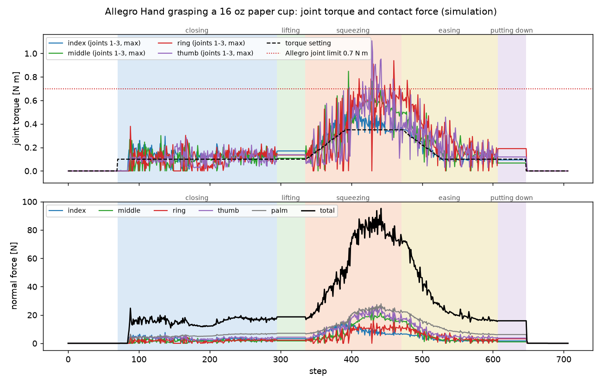

# 관절 토크

각 실험에서 Allegro Hand 손가락 관절에 걸린 토크입니다. **관절 토크 센서로 잰 값이 아니라**, 시뮬레이션이 계산한
접촉 법선력을 각 관절 축에 대해 모멘트로 합한 값입니다(마찰력 제외). 비교 기준은 Allegro Hand 관절이 낼 수 있는
토크 약 0.7 N·m입니다. 관절 이름은 손가락마다 0(벌림)·1(MCP)·2(PIP)·3(DIP)입니다.

## 종이컵 쥐기

{ loading=lazy }

| 단계 | 설정 | 관절 토크 최대(16개 관절 중, 순간값) |
|---|---|---|
| 쥐기 | 0.10 N·m | 0.38 N·m |
| 들기 | 0.10 N·m | 0.17 N·m |
| 꽉 쥐기 | 0.35 N·m | 1.11 N·m |
| 되돌리기 | 0.10 N·m | 0.77 N·m |
| 내려놓기 | 0.10 N·m | 0.19 N·m |

- 위 그래프는 손가락마다 굽힘 관절 셋 중 가장 큰 토크입니다. 관절은 설정 토크를 따라가도록 한 스텝씩 각도를 고치는 단순한 토크 서보라,
  컵이 손 안에서 단단해지는 꽉 쥐기 구간에서는 **스텝마다 오르내리며 설정값을 찾습니다**. 실제 로봇 제어기의 응답 특성을 뜻하지 않습니다.
- 꽉 쥐기 구간의 순간 최대(1.11 N·m)는 Allegro 한계를 넘습니다. 0.35 N·m 설정 자체는 가능한 범위입니다.
- 내려받기: [cup-grasp-joint-torque.csv](data/cup-grasp-joint-torque.csv) — 스텝·단계·설정·접촉력(합·손가락별)·관절 16개 토크

## 대표 데모 — 빠르게 쥐었다 놓치기

토크 그래프와 스텝당 계산 시간은 [대표 데모](demo.md)에 있습니다. 관절 토크 최대 0.97 N·m(쥐기 중 순간값), 들고 있는 동안 0.2 N·m 이하입니다.

- 내려받기: [cup-quick-demo.csv](data/cup-quick-demo.csv)

## 데이터 형식

CSV는 UTF-8, 첫 줄이 열 이름입니다. 단위는 열 이름 끝에 붙어 있습니다(`_N` 뉴턴, `_Nm` 뉴턴미터, `_mm` 밀리미터).
토크 부호는 관절 축 기준이며, 손가락을 여는 쪽으로 미는 토크가 음수입니다.
