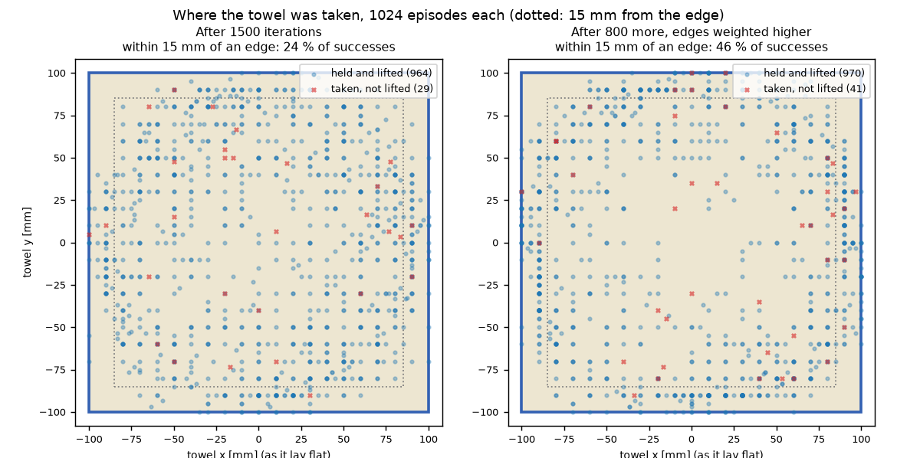

# 강화학습 데모 — 뭉툭한 손끝으로 수건 집기

탁자 위에 펼쳐 놓은 얇은 수건을 Allegro Hand가 집어 드는 동작을 강화학습(PPO)으로 배운 결과입니다. [수건 접기](towel.md)는
정해 둔 자리(모서리)를 정해 둔 손목 경로로 집었지만, 여기서는 **어디를 어떻게 집을지 정하지 않았습니다.** 정책이 손목과 손가락을
모두 정하고, 1024개 환경에서 스스로 집는 방법을 찾습니다.

같은 장면 1024개를 GPU 한 장(RTX 5080 16 GB)에서 동시에 돌려 학습했습니다. 기준: 2026-10-30, Isaac Sim 5.0.0 · Isaac Lab 2.2.1.
모든 결과는 시뮬레이션입니다. 수건은 MDE 천 모델이 계산하고, 표의 「집은 자리」·「늘어남」·「찢김」은 모두 MDE가 낸 값입니다.
소재 값은 가정값이며 실물로 재지 않았습니다. 보상 구성은 공개하지 않습니다.

!!! danger "재검증 중 (2026-10-30)"
    이 페이지의 학습 결과는 다시 계산하고 있습니다. 잡은 동안 실제 엄지와 중지 손끝이 약 9 mm 떨어져 있었고, 엄지는 천에
    닿지 않았습니다. 시뮬레이션의 엄지 패드가 실제 엄지 끝보다 약 1 cm 바깥에 놓여 있었고, 한 번 잡힌 천은 패드 간격이
    12 mm로 벌어질 때까지 놓이지 않았기 때문입니다. 패드를 손끝 형상에 맞추고, 손끝이 천을 사이에 두고 붙어 있을 때만
    잡힌 것으로 고쳐 다시 학습하고 있습니다. 아래 성공률·영상은 고치기 전 값입니다.

## 문제 — 뭉툭한 손끝은 펼친 천을 집지 못한다

Allegro Hand의 손끝은 지름 약 24 mm의 둥근 패드입니다. 두께 4 mm의 천이 탁자에 납작하게 깔려 있으면, 두 패드를 오므려도 패드 사이에
천이 들어오지 않고 패드끼리 천 위에서 만납니다. 사람은 천을 누른 채 손가락을 오므려 가운데를 솟게 하고, 솟은 부분을 잡거나
끝단을 들어 그 밑으로 손가락을 넣습니다.

[수건 접기](towel.md)의 집기는 「손끝이 모서리 근처 3 cm 안에 오면 천이 붙는다」는 규칙이었습니다. 이번에는 그 규칙을 없애고,
**천이 실제로 두 패드 사이에 끼었을 때만** 잡히도록 MDE 천 모델을 바꿨습니다.

## MDE에 더한 것

| 항목 | 내용 |
|---|---|
| 접촉으로 잡기 | 천이 두 패드 사이에 있고 **양쪽 패드에 모두 닿아 있을 때만** 잡힙니다. 패드 간격이 일정 이상 벌어지면 놓습니다 |
| 좌굴 | 오므리는 패드에 눌려 압축된 천이 탁자에서 위로 솟습니다. 이것이 없으면 같은 높이의 천은 압축돼도 솟지 않습니다 |
| 패드 마찰 | 탁자에 눌린 천은 패드 마찰(0.9)이 탁자 마찰(0.6)보다 크면 패드를 따라 끌려갑니다 |

손 없이 패드 두 개(지름 24 mm)만으로 먼저 확인했습니다. 수건 위로 내려와 오므린 뒤 8 cm 들어 올립니다.

| 경우 | 잡힘 | 잡힌 입자 | 최대 높이 | 최대 늘어남 |
|---|---|---|---|---|
| 가운데, 눌러서 오므림 | 예 | 3 | 89 mm | 0.28 (찢김 한계 0.15 초과) |
| 가운데, 패드 마찰 없음 | 아니요 | 0 | — | — |
| 가운데, 천 위에 띄운 채 오므림 | 아니요 | 0 | — | — |
| 끝단 10 mm 안쪽, 끝단을 따라 오므림 | 예 | 1 | 94 mm | 0.12 |
| 끝단, 끝단을 가로질러 오므림 | 아니요 | 0 | — | — |
| 모서리, 대각선으로 오므림 | 아니요(사이에 2개, 양쪽에 닿지 않음) | 0 | — | — |
| 모서리, 대각선으로 3 mm 더 눌러 오므림 | 예 | 1 | 94 mm | 0.18 |
| 모서리 끝을 가로질러 오므림 | 예 | 1 | 98 mm | 0.16 |
| 모서리 옆 끝단 8 mm 안쪽, 끝단을 따라 오므림 | 예 | 2 | 93 mm | 0.15 |
| 끝단 10 mm 안쪽, 끝단을 따라 오므림, 패드 마찰 없음 | 아니요 | 0 | — | — |
| 수건 밖 | 아니요 | 0 | — | — |

- 천 위에 띄운 채로는 잡히지 않습니다. **눌러서 솟게 해야** 잡힙니다.
- 가운데를 집으면 천이 솟을 만큼 모아야 해서 늘어남이 찢김 한계를 넘습니다. 끝단은 적게 모아도 잡혀 늘어남이 한계 아래입니다.
  끝단에서 집는 것이 유리한 이유가 MDE 물리에서 나옵니다.
- **패드 마찰이 없으면 가운데·끝단 모두 잡히지 않습니다.** 눌린 패드가 천을 붙잡고 끌어와야 두 패드 사이의 천이 압축되어 솟습니다.
- 모서리는 오므리는 방향과 누르는 깊이를 맞추면 잡힙니다. 늘어남은 0.15–0.18로 찢김 한계 근처입니다.

## 학습 조건

| 항목 | 값 |
|---|---|
| 수건 | 20 cm 정사각형, 면 수건(약 16 g), 두께 4 mm, 탁자와의 마찰계수 0.6, 입자 간격 10 mm — 모두 가정값 |
| 시작 상태 | 수건 위치 ±2 cm, 방향 ±45° 무작위. 손은 수건 가운데에서 ±10 cm 안 무작위 지점, 높이 4–7 cm, 방향 무작위 |
| 정책이 정하는 것 | 손가락 관절 16개, 손목 이동 속도(x·y·z)와 회전 속도. **집는 자리·집는 손가락·순서는 정하지 않음** |
| 집은 뒤 | 천이 잡히면 오므린 두 손가락이 패드 간격을 천 두께에 맞춰 유지합니다(쥐는 반사). 들어 올리기는 정책이 합니다 |
| 성공 | 집은 천을 6 cm 이상 들어 0.5초 유지, 찢김 없음 |
| 끝단 | 성공했을 때 집은 자리가 끝단·모서리에 가까울수록 더 높게 평가합니다. 끝단을 강제하지는 않습니다 |
| 안정성 검사(평가) | 성공 뒤 손가락을 고정한 채 손목을 5 cm 더 올리고 좌우 4 cm로 2초간 흔듭니다. 끝까지 쥐고 있으면 「흔들어도 유지」 |

## 결과

<figure><video class="mde-video" src="../media/demo/towel-pick-train.mp4" poster="../media/demo/towel-pick-train.jpg" controls muted loop playsinline preload="none"></video><figcaption>학습 과정: 학습 0·100·200·400·1000·1499·2298회 정책을 차례로 4개 장면씩(반 속도). 위 글자는 그 정책의 평가 성공률. 들어 올린 장면은 1초 뒤 처음 상태로 돌아갑니다</figcaption></figure>

<figure><video class="mde-video" src="../media/demo/towel-pick-mde.mp4" poster="../media/demo/towel-pick-mde.jpg" controls muted loop playsinline preload="none"></video><figcaption>학습된 정책 한 장면과 MDE 값(반 속도). 끝단 10 mm 안을 집어 들고, 흔들기 검사까지</figcaption></figure>

데이터 영상 오른쪽 그래프:

- **pinch** — 천을 잡았는지, 두 패드 사이 간격(수건 두께 4 mm 점선)
- **height** — 두 패드 사이에서 솟은 천의 높이, 잡힌 천의 높이와 목표(6 cm)
- **stretch** — 가장 많이 늘어난 가장자리와 찢김 한계(0.15)
- **지도** — 수건을 편 모양 위에 어디가 얼마나 늘어났는지, 잡힌 입자(하늘색 원)

### 학습이 진행되며

| 학습 횟수 | 평가 | 성공 | 한 번이라도 잡음 | 흔들어도 유지 | 찢김 | 걸린 시간 | 집은 자리 ~ 끝단 | 끝단 15 mm 안 |
|---|---|---|---|---|---|---|---|---|
| 0 (학습 전) | 256회 | 0 % | 0 % | — | 18 % | — | — | — |
| 100 | 256회 | 0 % | 61 % | — | 18 % | — | — | — |
| 200 | 256회 | 45 % | 87 % | 99 % | 15 % | 3.55 s | 60 mm | 1 % |
| 400 | 256회 | 70 % | 98 % | 100 % | 30 % | 1.23 s | 25 mm | 30 % |
| 1000 | 256회 | 93 % | 99 % | 98 % | 7 % | 1.13 s | 30 mm | 16 % |
| 1500 | 1024회 | 94 % | 97 % | 92 % | 6 % | 1.12 s | 30 mm | 24 % |
| **2300 (끝단 비중을 높여 800회 더)** | **1024회** | **95 %** | **99.5 %** | **100 %** | **5 %** | **1.10 s** | **17 mm** | **46 %** |

- 「흔들어도 유지」는 성공한 회차 중 비율, 「집은 자리 ~ 끝단」과 「끝단 15 mm 안」은 성공한 회차의 집은 자리(수건을 편 좌표)에서 셉니다.
  「집은 자리 ~ 끝단」은 중앙값입니다. 입자 간격이 10 mm라 집은 자리는 10 mm 단위입니다.
- 학습 전 정책도 18 %를 찢습니다. 패드로 천을 누른 채 손을 휘저어 끌고 가기 때문입니다.
- 학습 400회 정책은 찢김이 30 %였고, 찢긴 회차는 주로 수건 안쪽을 집은 경우였습니다. 학습이 진행되며 찢김이 줄었습니다.

### 끝단에서 집기

1500회까지는 집는 자리가 수건 전체에 고르게 퍼졌습니다. 끝단 15 mm 안의 비율 24 %는 집는 자리를 수건 위에서 아무 데나 고를 때(약 28 %)와
비슷합니다 — 끝단을 고르지 않았습니다. 끝단에 주는 비중을 높여 800회 더 학습하자 끝단 15 mm 안이 **46 %**로 늘고, 성공률과 흔들기 검사는
그대로이거나 나아졌습니다.

- 끝단 15 mm 안을 집은 회차는 잡고 못 든 비율이 2.4 %, 그보다 안쪽은 5–6 %입니다(2300회 정책).
- 집는 손은 주로 끝단 **변의 가운데 쪽**을 고르고, **모서리는 피합니다**(모서리 30 mm 안은 1 % 미만, 아무 데나 고를 때 약 7 %).
  물리 확인에서도 모서리는 대각선으로 오므려서는 잡히지 않았습니다. 모서리를 집으려면 끝단을 따라 오므리는 방향을 맞춰야 하는데,
  정책은 그 방법을 찾지 못했습니다.
- 정책이 찾은 집는 방법은 엄지와 다른 손가락 하나를 천 위에 눌러 대고 오므려, 그 사이에 솟은 천을 잡는 것입니다. 잡히는 천은 대부분
  입자 1개(10 mm 격자 한 칸)입니다.

## 한계

- 패드는 지름 24 mm의 구로, 천은 입자 간격 10 mm의 격자로 근사했습니다. 「잡힌 입자 1개」는 10 mm 격자 한 칸입니다.
- 미끄러짐·마찰 한계로 천이 빠지는 것은 계산하지 않습니다. 잡힌 천은 패드 간격이 벌어질 때만 놓입니다.
- 수건 소재 값과 패드 마찰은 가정값입니다.
- 손가락끼리의 충돌이 없어, 천 없이 오므리면 엄지와 검지 끝이 서로를 통과합니다. 닫는 순간 패드 간격이 0 아래로 잠깐 내려가는
  것이 이 때문입니다.
- 정책은 수건 입자 25개의 위치를 직접 봅니다. 실물에서는 카메라로 수건의 모양을 추정해야 합니다.
- 집은 뒤의 패드 간격은 쥐는 반사가 유지하고, 정책은 집기 전 동작과 들어 올리기를 정합니다.
- seed 1개로 한 번 학습한 결과입니다.
