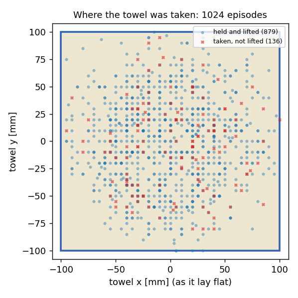
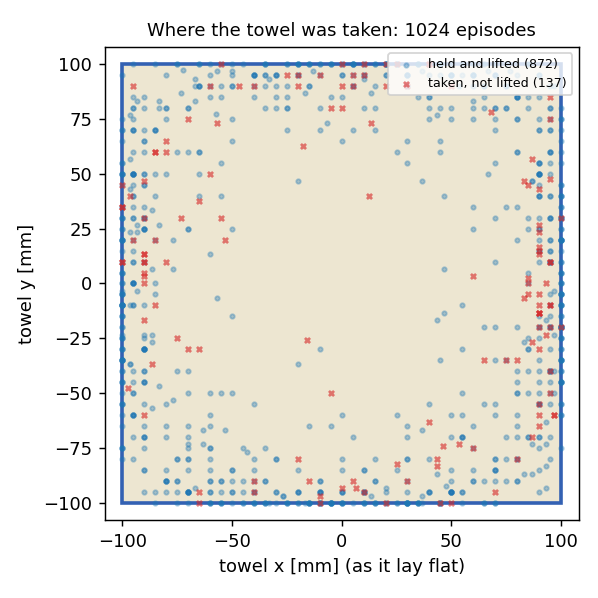

# 강화학습 데모 — 뭉툭한 손끝으로 수건 집기

탁자 위에 펼쳐 놓은 얇은 수건을 Allegro Hand가 집어 드는 동작을 강화학습(PPO)으로 배운 결과입니다. [수건 접기](towel.md)는
정해 둔 자리(모서리)를 정해 둔 손목 경로로 집었지만, 여기서는 **어디를 어떻게 집을지 정하지 않았습니다.** 정책이 손목과 손가락을
모두 정하고, 1024개 환경에서 스스로 집는 방법을 찾습니다.

같은 장면 1024개를 GPU 한 장(RTX 5080 16 GB)에서 동시에 돌려 2000회 학습했고, 끝단에서 집도록 800회를 더 학습했습니다. 기준: 2026-10-31, Isaac Sim 5.0.0 · Isaac Lab 2.2.1.
모든 결과는 시뮬레이션입니다. 수건은 MDE 천 모델이 계산하고, 표의 「집은 자리」·「늘어남」·「찢김」은 모두 MDE가 낸 값입니다.
소재 값은 가정값이며 실물로 재지 않았습니다. 보상 구성은 공개하지 않습니다.

!!! note "고친 내용 (2026-10-31)"
    10-30에 올린 결과는 잡은 동안 두 손끝이 실제로는 떨어져 있었습니다. 시뮬레이션이 천을 잡는 데 쓰는 패드(구)를 손끝의 둥근
    **끝머리**에 맞췄는데, 손끝이 천을 집는 면은 끝머리가 아니라 **손바닥 쪽 얇은 면**(중심에서 6–7 mm)입니다. 그 방향으로 패드가
    손끝 밖으로 엄지 8.5 mm, 검지 3.7 mm 튀어나와 있어, 패드끼리는 천을 사이에 두고 붙었어도 손끝 모양은 5.8 mm 떨어져 있었고
    천은 그 사이 허공에 떠 있었습니다. 패드를 손끝 끝 쪽의 집는 면에 다시 맞추고(반지름 6.5 mm, 손끝 표면에서 0.5 mm 안),
    처음부터 다시 학습했습니다. 아래는 모두 고친 뒤의 값입니다.

## 문제 — 뭉툭한 손끝은 펼친 천을 집지 못한다

두께 4 mm의 천이 탁자에 납작하게 깔려 있으면, 두 손끝을 오므려도 그 사이에 천이 들어오지 않고 손끝끼리 천 위에서 만납니다.
사람은 천을 누른 채 손가락을 오므려 가운데를 솟게 하고, 솟은 부분을 잡거나 끝단을 들어 그 밑으로 손가락을 넣습니다.

[수건 접기](towel.md)의 초기 집기는 「손끝이 모서리 근처에 오면 천이 붙는다」는 규칙이었습니다. 여기서는 그 규칙을 없애고,
**천이 실제로 두 패드 사이에 끼어 양쪽에 닿아 있을 때만** 잡히도록 MDE 천 모델을 바꿨습니다.

| 항목 | 내용 |
|---|---|
| 접촉으로 잡기 | 천이 두 패드 사이에 있고 **양쪽 패드에 모두 닿아 있을 때만** 잡힙니다. 패드 간격이 천 두께(4 mm)보다 벌어지면 놓고, 그보다 벌어진 채로는 잡히지도 않습니다 |
| 좌굴 | 오므리는 패드에 눌려 압축된 천이 탁자에서 위로 솟습니다 |
| 패드 마찰 | 탁자에 눌린 천은 패드 마찰(0.9)이 탁자 마찰(0.6)보다 크면 패드를 따라 끌려갑니다. 패드 마찰이 없으면 아무것도 잡히지 않습니다 |
| 쥐는 반사 | 천이 잡히면 오므린 두 손가락이 패드 간격을 1.5 mm(눌린 천)로 맞춥니다. 구동부 유격으로 에피소드마다 최대 1 mm 더 벌어질 수 있습니다 |

## 학습 조건

| 항목 | 값 |
|---|---|
| 수건 | 20 cm 정사각형, 면 수건(약 16 g), 두께 4 mm, 탁자와의 마찰계수 0.6, 입자 간격 10 mm — 모두 가정값 |
| 시작 상태 | 수건 위치 ±2 cm, 방향 ±45° 무작위. 손은 수건 가운데 ±10 cm 안 또는 모서리 위, 높이 4–7 cm, 방향 무작위 |
| 정책이 정하는 것 | 손가락 관절 16개, 손목 이동 속도(x·y·z)와 회전 속도. **집는 자리·집는 손가락·순서는 정하지 않음** |
| 성공 | 집은 천을 6 cm 이상 들어 0.5초 유지, 찢김 없음 |
| 안정성 검사(평가) | 성공 뒤 손가락을 고정한 채 손목을 5 cm 더 올리고 좌우 4 cm로 2초간 흔듭니다. 끝까지 쥐고 있으면 「흔들어도 유지」 |

## 잡았을 때 손끝이 붙어 있는가

학습된 정책을 64개 장면에서 돌리며, 천을 잡고 있는 순간 2076개에서 실제 손끝 모양(메시)끼리의 거리를 쟀습니다.

| | 고치기 전 | 고친 뒤 |
|---|---|---|
| 패드 사이 간격 (중앙값) | −6.4 mm (패드끼리 겹침) | **1.3 mm** (천이 눌려 끼어 있음) |
| 엄지와 짝 손가락 손끝 모양 사이 최소 거리 (중앙값) | 5.8 mm | **0 mm** (90 %가 2.5 mm 안) |
| 패드가 손끝 밖으로 나온 정도 (중앙값) | 엄지 8.5 mm | 없음 (손끝 안쪽 0.7 mm) |

정책이 고른 짝 손가락은 모두 검지였습니다(엄지–검지 집기).

## 결과

<figure><video class="mde-video" src="../media/demo/towel-pick2-train.mp4" poster="../media/demo/towel-pick2-train.jpg" controls muted loop playsinline preload="none"></video><figcaption>학습 과정: 학습 0·300·700·1999회 정책을 차례로 4개 장면씩. 위 글자는 그 정책의 평가 성공률</figcaption></figure>

<figure><video class="mde-video" src="../media/demo/towel-pick2-mde.mp4" poster="../media/demo/towel-pick2-mde.jpg" controls muted loop playsinline preload="none"></video><figcaption>학습된 정책 한 장면과 MDE 값: 엄지와 검지 끝이 천을 사이에 두고 붙어 들어 올린 뒤 흔들기 검사까지</figcaption></figure>

데이터 영상 오른쪽 그래프:

- **pinch** — 천을 잡았는지, 두 패드 사이 간격(수건 두께 4 mm 점선)
- **height** — 잡힌 천의 높이와 목표(6 cm)
- **stretch** — 가장 많이 늘어난 가장자리와 찢김 한계(0.15)
- **지도** — 수건을 편 모양 위에 어디가 얼마나 늘어났는지, 잡힌 입자(하늘색 원)

### 학습이 진행되며

| 학습 횟수 | 평가 | 성공 | 한 번이라도 잡음 | 흔들어도 유지 | 찢김 | 걸린 시간(중앙값) | 집은 자리 ~ 끝단 | 끝단 15 mm 안 |
|---|---|---|---|---|---|---|---|---|
| 0 (학습 전) | 256회 | 0 % | 0 % | — | 0.4 % | — | — | — |
| 300 | 256회 | 60 % | 84 % | 99 % | 32 % | 1.78 s | 55 mm | 4 % |
| 700 | 256회 | 88 % | 97 % | 89 % | 12 % | 1.51 s | 54 mm | 0.4 % |
| 1200 | 256회 | 84 % | 100 % | 85 % | 16 % | 1.37 s | 50 mm | 2 % |
| **1999** | **1024회** | **86 %** | **99 %** | **89 %** | **14 %** | **1.37 s** | **50 mm** | **5 %** |

- 「흔들어도 유지」는 성공한 회차 중 비율, 「집은 자리 ~ 끝단」(중앙값)과 「끝단 15 mm 안」은 성공한 회차의 집은 자리(수건을 편 좌표)에서
  셉니다. 입자 간격이 10 mm라 집은 자리는 10 mm 단위입니다. 잡히는 천은 중앙값 입자 2개입니다.

## 끝단에서 집기 — 추가 학습

위 정책(1999회)은 수건 전체에 고르게 집었고, 끝단 15 mm 안은 5 %뿐이었습니다. 아무 데나 고를 때(끝단 약 28 %)보다 적습니다.
빨리 집는 것이 끝단까지 가는 것보다 유리했기 때문입니다. 끝단·모서리에서 집은 성공을 훨씬 크게 치도록 학습 목표를 바꾸고,
1999회 정책에서 이어 800회를 더 학습했습니다(1024개 환경).

<figure><video class="mde-video" src="../media/demo/towel-pick3-train.mp4" poster="../media/demo/towel-pick3-train.jpg" controls muted loop playsinline preload="none"></video><figcaption>끝단 추가 학습 과정: 2000·2200·2400·2798회 정책을 차례로 4개 장면씩. 위 글자는 그 정책의 평가 성공률</figcaption></figure>

<figure><video class="mde-video" src="../media/demo/towel-pick3-edge.mp4" poster="../media/demo/towel-pick3-edge.jpg" controls muted loop playsinline preload="none"></video><figcaption>끝단 5 mm 안을 집어 들고 흔들기 검사까지 (오른쪽 아래 지도의 하늘색 원이 잡힌 입자)</figcaption></figure>

<figure><video class="mde-video" src="../media/demo/towel-pick3-corner.mp4" poster="../media/demo/towel-pick3-corner.jpg" controls muted loop playsinline preload="none"></video><figcaption>모서리에서 18 mm 떨어진 자리를 집은 장면</figcaption></figure>

| 학습 횟수 | 평가 | 성공 | 흔들어도 유지 | 찢김 | 걸린 시간(중앙값) | 집은 자리 ~ 끝단 | **끝단 15 mm 안** | 모서리 30 mm 안 |
|---|---|---|---|---|---|---|---|---|
| 1999 (추가 학습 전) | 1024회 | 86 % | 89 % | 14 % | 1.37 s | 50 mm | 5 % | 0.3 % |
| 2200 | 256회 | 88 % | 87 % | 12 % | 1.50 s | 40 mm | 16 % | 1 % |
| 2400 | 256회 | 93 % | 88 % | 7 % | 1.37 s | 20 mm | 35 % | 5 % |
| **2798** | **1024회** | **85 %** | **88 %** | **15 %** | **1.42 s** | **5 mm** | **71 %** | **9 %** |

- 성공률과 흔들어도 유지는 그대로 두고, 집는 자리가 끝단으로 옮겨 갔습니다. 집은 자리 중앙값이 끝단에서 5 mm(입자 간격 10 mm의 반 칸)입니다.
- 끝단에서 집을 때도 손끝은 맞닿아 있습니다: 64개 장면, 잡은 순간 1966개에서 엄지–검지 손끝 모양 사이 최소 거리 중앙값 0 mm,
  패드 사이 간격 중앙값 1.5 mm. 짝 손가락은 모두 검지였습니다.
- 모서리는 9 %로 늘었지만, 정책은 주로 변의 가운데 쪽을 집습니다. 모서리를 고르는 것은 다음 단계입니다.

## 여러 손가락으로 집기 — 실패 기록

엄지와 검지·중지·약지가 각각 짝을 이뤄 천을 잡게 하고(짝마다 따로 잡고 놓음), 두 쌍·세 쌍을 쓰는 집기를 강화학습이 찾게 했습니다.
**여섯 번 학습해 여섯 번 모두 엄지와 손가락 한 쌍으로만 잡았습니다.** 성공하지 못한 영상과 천이 찢어지는 영상을 그대로 싣습니다.
이 실험에서 얻은 것은 「왜 안 되는가」이며, 그 답이 모델과 과제를 어떻게 바꿔야 하는지를 정합니다.

| 학습 | 바꾼 것 | 성공 조건 | 성공 | 끝까지 한 쌍으로만 잡은 장면 | 찢김 |
|---|---|---|---|---|---|
| multi01 (2000회) | 짝 손가락을 정하지 않음 | 한 쌍 이상 | 24 % | 100 % | 20 % |
| multi02 (+1000회) | 다른 손가락을 쓰도록 학습 목표 추가 | 한 쌍 이상 | 20 % | 100 % | 10 % |
| multi03 (+1000회) | 그 목표가 10 cm 거리부터 작동하게 | 한 쌍 이상 | 34 % | 100 % | 12 % |
| tripod01 (처음부터 2000회) | 손가락 셋이 엄지를 둘러싼 자세에서 시작 | **두 쌍 이상** | **0 %** | 97 % | 34 % |
| tripod02 (+1000회) | 두 쌍으로 쥐어야 학습 목표를 온전히 받게 | 두 쌍 이상 | **0 %** | 99.6 % | 39 % |
| tripod03 (+1000회) | 천 모델: 둘째 쌍이 이미 잡힌 천 뭉치를 함께 물 수 있게 | 두 쌍 이상 | **0 %** | 100 % | 17 % |

모두 1024개 환경에서 학습하고 정책을 고정해 1024회 평가한 값입니다. 「끝까지 한 쌍으로만」은 천을 잡은 장면 가운데 두 쌍이 동시에 잡은 순간이 한 번도 없었던 비율입니다. multi01–03에서 정책은 1024회 모두 엄지–검지만,
tripod01–03은 주로 엄지–중지만 썼습니다.

<figure><video class="mde-video" src="../media/demo/towel-pick4-train.mp4" poster="../media/demo/towel-pick4-train.jpg" controls muted loop playsinline preload="none"></video><figcaption>tripod01 학습 과정: 0·300·1000·1999회 정책을 차례로 4개 장면씩. 천은 잡지만 두 쌍으로는 잡지 않아 평가 성공률은 끝까지 0 %</figcaption></figure>

<figure><video class="mde-video" src="../media/demo/towel-pick4-tear.mp4" poster="../media/demo/towel-pick4-tear.jpg" controls muted loop playsinline preload="none"></video><figcaption>찢김 (tripod02): 엄지–중지 한 쌍으로 52 mm 들어 올린 채 버티다가, 잡은 자리 주변 늘어남이 MDE 찢김 한계 0.15를 넘어 3.1 s에 찢어집니다</figcaption></figure>

<figure><video class="mde-video" src="../media/demo/towel-pick4-tear-low.mp4" poster="../media/demo/towel-pick4-tear-low.jpg" controls muted loop playsinline preload="none"></video><figcaption>찢김 (tripod01): 탁자 가까이(12 mm)에서 쥔 채 손을 움직이다 놓치고 다시 잡는 사이 늘어남이 한계를 넘어 4.3 s에 찢어집니다</figcaption></figure>

<figure><video class="mde-video" src="../media/demo/towel-pick4-onepair.mp4" poster="../media/demo/towel-pick4-onepair.jpg" controls muted loop playsinline preload="none"></video><figcaption>실패로 판정된 들어 올리기 (tripod03): 한 번 놓쳤다 다시 잡고 목표 높이(60 mm) 위로 들어 끝까지 버팁니다. 한 쌍이라 성공으로 치지 않았습니다</figcaption></figure>

<figure><video class="mde-video" src="../media/demo/towel-pick4-train3.mp4" poster="../media/demo/towel-pick4-train3.jpg" controls muted loop playsinline preload="none"></video><figcaption>tripod03 학습 과정(천 모델을 고친 뒤): 3000·3300·3600·3997회 정책. 둘째 쌍은 끝까지 잡지 않습니다</figcaption></figure>

### 왜 안 되었나

- **한 쌍이면 충분했다.** multi01–03에서 엄지–검지 한 쌍으로 끝단을 잡으면 흔들기 검사 뒤 96–98 %가 그대로 잡혀 있었습니다.
  손가락을 더 쓰면 동작만 복잡해지고 얻는 것이 없으니, 정책은 가장 단순한 한 쌍을 골랐습니다.
- **조건만 두 쌍으로 묶으면, 한 쌍으로 쥔 채 버티는 것을 배운다 (tripod01).** 성공은 두 쌍이어야 하지만 쥐고 들어 올리는 동안의
  학습 목표는 한 쌍에도 다 주어졌습니다. 정책은 성공을 포기하고 한 쌍으로 쥔 채 에피소드 끝까지 버텼고, 오래 쥔 만큼 찢김이 늘었습니다(34 %).
- **다가가도 잡을 천이 없다 (tripod02).** 학습 목표를 고치자 검지가 엄지에서 8.8 mm(중앙값), 가까울 때 4.2 mm까지 왔습니다(천을 놓는 기준 4 mm).
  그래도 한 번도 잡지 못했습니다. 두 가지를 따로 확인했습니다.
    - 첫 쌍이 잡은 자세에서 검지는 자기 관절만으로 엄지 끝에 닿을 수 있습니다(48개 자세 모두, 관절 각도 탐색).
    - 검지를 강제로 굽히면 엄지를 비켜 지나가 25 mm로 멀어집니다.

    이 천 모델에서 잡힌 천은 첫 쌍의 두 손끝 사이로 모여 붙습니다. 옆에서 다가온 검지와 엄지 사이에는 아직 안 잡힌 천이 남아
    있지 않습니다. 두 쌍 집기는 두 쌍이 같은 순간에 닫힐 때만 생깁니다(tripod01 평가 장면의 2.7 %에서 잠깐).
- **잡을 수 있게 고쳐도 쓰지 않는다 (tripod03).** 둘째 손가락이 이미 잡힌 천 뭉치를 엄지에 함께 눌러 물면 그 쌍도 잡은 것으로
  치고, 첫 쌍이 벌어지면 둘째 쌍이 넘겨받도록 천 모델을 고쳤습니다. 검지는 오히려 12.8 mm로 물러났습니다. 첫 번째 이유가 그대로
  남아 있기 때문입니다 — 이 수건과 이 흔들기에서는 한 쌍이 실패하지 않습니다.

### 다음 단계

여러 손가락이 필요한 상황은 **한 쌍으로는 실패하는 상황**입니다. 무겁거나 큰 천(한 점에 무게가 몰려 찢기거나 빠짐), 손가락
구동부 유격이 커서 한 쌍이 벌어지는 경우, 더 센 흔들림이 그 후보입니다. 그런 조건을 모델에 넣기 전에는 강화학습이 여러 손가락을
고를 이유가 없습니다.

## 한계

- 패드는 반지름 6.5 mm의 구로, 천은 입자 간격 10 mm의 격자로 근사했습니다. 「잡힌 입자 2개」는 10 mm 격자 두 칸입니다.
- 미끄러짐·마찰 한계로 천이 빠지는 것은 계산하지 않습니다. 잡힌 천은 패드 간격이 벌어질 때만 놓입니다.
- 수건 소재 값과 패드 마찰은 가정값입니다.
- 정책은 수건 입자 25개의 위치를 직접 봅니다. 실물에서는 카메라로 수건의 모양을 추정해야 합니다.
- 집은 뒤의 패드 간격은 쥐는 반사가 유지하고, 정책은 집기 전 동작과 들어 올리기를 정합니다.
- seed 1개로 한 번 학습한 결과입니다.
