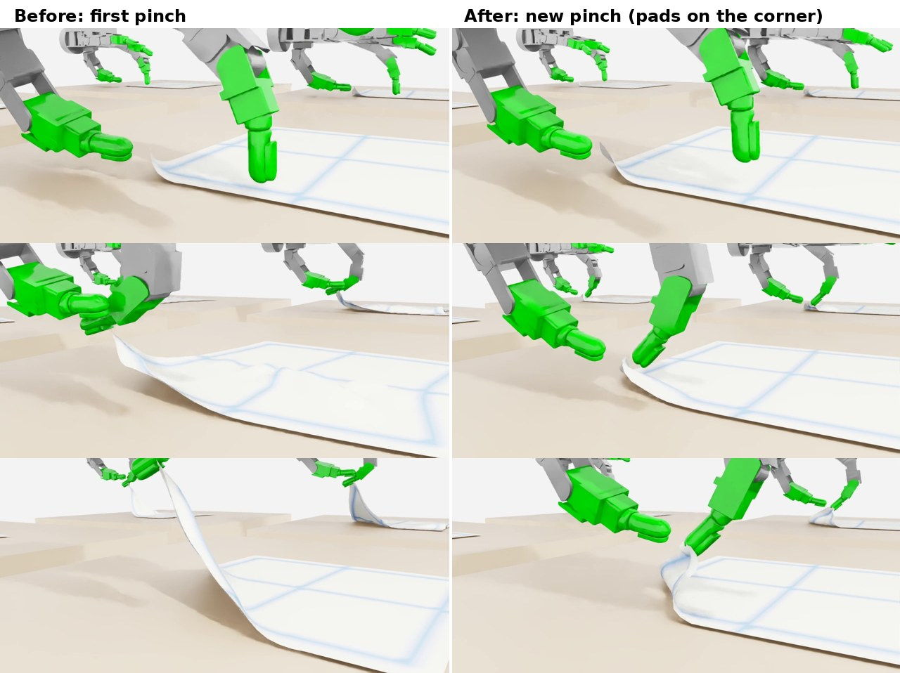
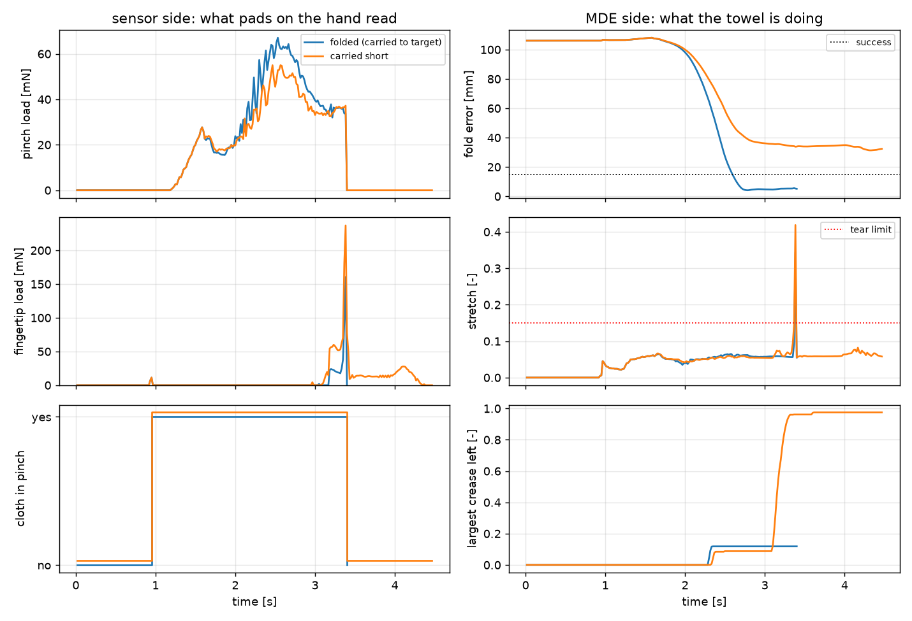

# 강화학습 데모 — 수건 접기

Isaac Lab에서 Allegro Hand가 탁자 위 수건을 집어 접는 동작을 강화학습(PPO)으로 배운 결과입니다. 네 단계로 나눠 보였습니다.

1. **수건을 안정적으로 잡기** — 모서리를 손끝으로 실제로 집고, 옮기는 동안 놓치지 않기
2. **1번 접기** — 대각선으로 반 접기
3. **2번 접기** — 반 접은 수건을 한 번 더 접기 (**집기를 고친 뒤로는 아직 못 함**)
4. **가장 빠르게 접기** — 1번 접기를 속도 상한을 올려 다시 학습

같은 장면 1024개를 GPU 한 장(RTX 5080 16 GB)에서 동시에 돌려 학습했습니다. 기준: 2026-10-31, Isaac Sim 5.0.0 · Isaac Lab 2.2.1.
모든 결과는 시뮬레이션입니다.

**수건은 MDE 천 모델이 계산합니다.** 1024개 환경의 수건을 MDE가 GPU에서 한꺼번에 풀고, 손가락이 천을 밀고 집는 것도 MDE 안에서
처리합니다. MDE는 매 순간 수건의 모양, 가장자리가 얼마나 늘어났는지(찢어질 위험), 접힌 자리에 남은 주름을 냅니다.
화면의 수건은 그 계산 결과를 그대로 그린 것이고, 아래 표의 「집은 자리」·「접힘 오차」·「늘어남」·「찢김」도 전부 MDE가 낸 값입니다.
소재 값은 가정값이며 실물로 재지 않았습니다. 보상 구성은 공개하지 않습니다.

집는 자리와 방법을 정하지 않고 뭉툭한 손끝으로 펼친 수건을 집는 학습은 [수건 집기 — 뭉툭한 손끝](towel-pick.md)에 있습니다.

!!! note "고친 내용 (2026-10-31)"
    10-30에 올린 결과는 집기 판정에 결함이 있었습니다. 시뮬레이션이 천을 잡는 데 쓰는 패드가 실제 손끝 밖으로 튀어나와 있어,
    잡은 동안 엄지–검지 손끝 사이가 중앙값 7.6 mm 떨어져 있었고 천은 그 사이 허공에 떠 있었습니다(가장 빠른 정책 ④ 기준).
    패드를 손끝이 천을 집는 면(손바닥 쪽)에 다시 맞추고, **천이 두 패드 사이에 끼어 양쪽에 닿아 있을 때만** 잡히도록 바꾼 뒤
    ②·④를 처음부터 다시 학습했습니다. 아래 ①·②·④는 고친 뒤의 값입니다. ③은 고친 집기로 아직 성공하지 못해, 10-30에 올린
    결과를 거둬들였습니다. 바뀐 패드는 [수건 집기 — 뭉툭한 손끝](towel-pick.md)과 같습니다.

## 공통 조건

| 항목 | 값 |
|---|---|
| 수건 | 20 cm 정사각형, 면 수건(면적당 0.40 kg/m², 약 16 g), 두께 4 mm, 탁자와의 마찰계수 0.6, 입자 간격 10 mm — 모두 가정값 |
| 동작 | 가까운 모서리를 엄지와 검지로 집어 들고, 접을 자리 위로 옮겨 내려놓은 뒤 놓기 |
| 정책이 정하는 것 | 손가락 관절 16개의 보정, 손목 위치 보정, 정해 둔 손목 경로를 따라가는 **속도** |
| 성공 | 접힌 두 면이 15 mm 안으로 겹치고, 모서리를 집어 접었고(집은 자리 중심이 모서리에서 35 mm 안), 손을 놓았고, 가장자리 늘어남이 찢김 한계(15 %)를 넘지 않음. 성공하는 순간 끝나므로 빠를수록 유리합니다 |
| 평가 | 정책을 고정하고 128회(손끝 간격은 64개 장면) |

## 데이터 영상 읽는 법

각 단계의 두 번째 영상은 한 장면을 반 속도로 보이며, 오른쪽에 MDE가 그 순간 내는 값을 그립니다.

- **pinch** — 천을 집고 있는지, 엄지·검지 패드 사이 간격(수건 두께 4 mm 점선)
- **fold error** — 접힌 두 면의 어긋남과 성공 기준(15 mm)
- **stretch** — 가장 많이 늘어난 가장자리와 찢김 한계(0.15)
- **지도 두 장** — 수건을 편 모양 위에 「어디가 얼마나 늘어났는지」와 「어디에 접힌 자국이 남았는지」

## ① 수건을 안정적으로 잡기

처음 학습한 정책은 **모서리에서 35 mm 안쪽**을 집었습니다. 접힘 오차만 보면 성공처럼 보였지만, 모서리 끝이 밑으로 말려 들어간 채
구겨져 접혔습니다. 그래서 집는 손끝을 모서리 쪽으로 옮기고, 성공 판정에 「모서리를 집었는가」를 넣었습니다. MDE가 어떤 입자를
집었는지 알려 주므로, 집은 자리의 중심이 모서리 근처일 때만 접기로 칩니다.

그 뒤 패드 결함(위 상자)을 고쳤습니다. 이제는 손끝 모양끼리 실제로 닿아야 천이 잡힙니다. 고친 정책이 잡고 옮기는 동안을 64개
장면에서 쟀습니다.

| | 엄지–검지 손끝 모양 사이 최소 거리 | 패드 사이 간격 | 집은 자리 중심 ~ 모서리 | 모서리를 집은 비율 |
|---|---|---|---|---|
| 고치기 전 ④ 정책(10-30) | 7.6 mm | 4.5 mm | 0 mm (판정 결함) | — |
| **고친 뒤 ② 1번 접기 정책** | **0 mm** (90 %가 0.2 mm 안) | 2.3 mm | 29 mm | 128/128 |
| **고친 뒤 ④ 가장 빠른 정책** | **0 mm** (90 %가 0 mm) | 2.3 mm | 18 mm | 128/128 |

- 값은 중앙값입니다. 패드 사이 간격이 수건 두께(4 mm)보다 작으면 천이 두 손끝 사이에 눌려 끼어 있는 것입니다.
- 손끝은 천을 끝머리가 아니라 손바닥 쪽 면으로 집습니다. 그 면이 모서리 입자에 닿으려면 손끝이 모서리보다 조금 안쪽에 와야 해서,
  집은 자리는 모서리에서 18–29 mm(입자 간격 10 mm로 2–3칸)입니다. 영상에서 모서리 끝은 말리지 않고 접혔습니다.

## ② 1번 접기

<figure><video class="mde-video" src="../media/demo/towel-fold1b.mp4" poster="../media/demo/towel-fold1b.jpg" controls muted loop playsinline preload="none"></video><figcaption>학습 전·중간·학습 후 한 장면 확대, 끝에 학습된 정책 16개 장면. 성공한 장면은 잠시 뒤 처음 상태로 돌아갑니다</figcaption></figure>

<figure><video class="mde-video" src="../media/demo/towel-fold1b-mde.mp4" poster="../media/demo/towel-fold1b-mde.jpg" controls muted loop playsinline preload="none"></video><figcaption>학습된 정책 한 장면과 MDE 값: 엄지와 검지 끝이 모서리를 사이에 두고 붙어 옮긴 뒤 놓습니다</figcaption></figure>

| | 성공 | 걸린 시간 | 접힘 오차(중앙값) | 찢김 | 가장 많이 늘어난 가장자리 |
|---|---|---|---|---|---|
| 정해 둔 동작, 일정 속도 1배 | 61/64 | 3.42 s | 7.5 mm | 0 | 10.2 % |
| **강화학습(속도 상한 2.5배, 1500회)** | **127/128** | **1.37 s** | 8.2 mm | **0/128** | 11.8 % (한계 15 %) |

- 정책은 정해 둔 동작보다 **2.5배** 빨리 접고, 접힘 오차는 비슷합니다(성공 기준 15 mm 안).
- 가장 많이 늘어난 가장자리는 회차마다의 최대값을 평균한 것입니다.

## ③ 2번 접기 — 고친 집기로는 아직 못 함

반 접은 수건(삼각형)의 남은 모서리를 한 번 더 집어 접는 단계입니다. 10-30에 올린 결과(127/128 성공)는 패드 결함이 있던 집기로
낸 것이라 거둬들였습니다.

고친 집기로는 정해 둔 동작도 3 % 이하만 성공합니다. 두 번째로 집는 자리는 이미 두 겹이 된 천인데, 손끝 사이에 끼는 입자가
대개 하나뿐이라 옮기는 동안 빠집니다. 집는 자리와 속도를 여러 가지로 바꿔도 같았습니다. 겹친 천을 집는 것을 천 모델이 다루도록
바꾼 뒤 다시 학습할 예정입니다.

## ④ 가장 빠르게 접기

<figure><video class="mde-video" src="../media/demo/towel-fastest2.mp4" poster="../media/demo/towel-fastest2.jpg" controls muted loop playsinline preload="none"></video><figcaption>속도 상한 4배로 다시 학습한 정책. 학습 전·중간·학습 후 한 장면 확대, 끝에 16개 장면</figcaption></figure>

<figure><video class="mde-video" src="../media/demo/towel-fastest2-mde.mp4" poster="../media/demo/towel-fastest2-mde.jpg" controls muted loop playsinline preload="none"></video><figcaption>가장 빠른 정책 한 장면과 MDE 값</figcaption></figure>

| | 성공 | 걸린 시간 | 접힘 오차(중앙값) | 찢김 | 가장 많이 늘어난 가장자리 |
|---|---|---|---|---|---|
| 정해 둔 동작, 1배 | 61/64 | 3.42 s | 7.5 mm | 0 | 10.2 % |
| ② 정책(상한 2.5배) | 127/128 | 1.37 s | 8.2 mm | 0/128 | 11.8 % |
| **④ 정책(상한 4배, 1000회)** | **128/128** | **0.87 s** | 10.4 mm | **0/128** | 13.0 % (한계 15 %) |

- 정해 둔 동작보다 **3.9배**, ② 정책보다 1.6배 빠릅니다. 그 대가로 접힘 오차와 늘어남이 조금 큽니다.
- 늘어남은 찢김 한계 아래에 있습니다. 4배로 빨리 옮겨도 이 수건(가정값)은 찢기지 않았습니다.

## 손끝 센서 신호와 MDE 신호

손끝 센서가 읽을 수 있는 신호와 MDE가 주는 수건의 상태를 같은 동작에서 나란히 그렸습니다. 두 경우는 같은 집기·속도(1배)이고,
모서리를 옮기는 거리만 다릅니다(목표까지 옮김 / 덜 옮김).

| | 집게 하중 평균 / 최대 | 집고 있던 구간 | **접힘 오차** | 남은 주름(최대) | 결과 |
|---|---|---|---|---|---|
| 목표까지 옮김 | 31 / 67 mN | 0.95–3.4 s | **5.2 mm** | 0.12 | 성공 |
| 덜 옮김 | 27 / 55 mN | 0.95–3.4 s | **32 mm** | 0.98 | 실패 |

- **왼쪽(센서 쪽)** — 집게에 걸리는 하중, 손끝에 닿는 하중, 천을 집고 있는지. 두 경우의 곡선이 거의 같아 이 신호로는 잘 접었는지 알 수 없습니다.
  센서는 「무엇을 얼마나 세게 잡았나」만 알려 줍니다.
- **오른쪽(MDE 쪽)** — 두 반쪽이 얼마나 어긋났는지, 가장자리가 얼마나 늘어났는지, 어디에 주름이 남았는지. 접기의 성패는 이쪽에서 갈립니다.
  덜 옮긴 수건은 반쪽이 32 mm 어긋난 채 엉뚱한 자리가 깊게 접혀 주름이 남았습니다.
- 센서 쪽 값은 시뮬레이션 안에서 손끝·집게에 걸리는 하중을 추정한 것이며, 실제 센서로 잰 값이 아닙니다.
- 이 비교는 ①의 집기와 패드를 고치기 전 동작으로 그렸습니다.

## MDE를 쓰는 이유

1. **센서가 볼 수 없는 물체의 상태를 줍니다.** 어느 자리를 집었는지, 접힘 정렬, 늘어남, 남은 주름은 손에 붙은 센서로는 읽을 수 없습니다.
   ①의 「35 mm 안쪽 집기」도 접힘 오차만으로는 보이지 않았고, MDE가 집은 입자를 알려 줘서 잡아냈습니다.
2. **소재가 정하는 한계를 학습 안에 넣을 수 있습니다.** 찢김 판정이 있어 정책은 빨리 접되 수건이 버티는 범위 안에서 움직입니다.
3. **천을 1024개 환경에서 함께 학습할 수 있습니다.** 수건 1024장을 GPU에서 한꺼번에 계산합니다.
4. **접은 자리가 남습니다.** 같은 동작이라도 어디를 얼마나 접었는지에 따라 결과 모양이 달라집니다.

## 한계

- 수건 소재 값(무게·늘어나는 정도·찢김 한계·마찰)은 가정값이고, 실물 수건으로 맞추지 않았습니다.
- 손목은 정해 둔 경로를 따르고, 정책은 그 경로의 속도와 작은 보정만 정합니다. 수건은 매번 같은 자리에 반듯하게 놓여 있습니다.
- 각 단계는 seed 1개로 한 번 학습한 결과입니다.
- 패드는 반지름 6.5 mm의 구로, 천은 입자 간격 10 mm의 격자로 근사했습니다. 미끄러짐으로 천이 빠지는 것은 계산하지 않습니다.
- 손과 천은 한 방향으로만 작용합니다(손이 천을 밀고 집지만, 천이 손을 밀어내지는 않습니다).
